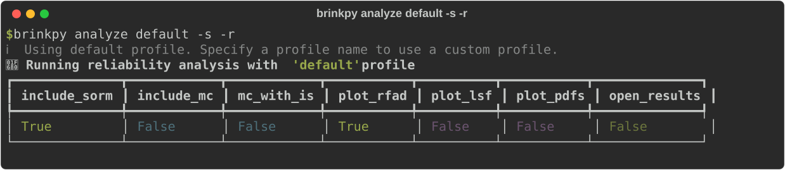

# Analyze: Forward Reliability Assessment

Run forward reliability analysis to estimate the failure probability, the reliability index (β), and the most probable point (MPP). The First-Order Reliability Method (FORM) always runs. The Second-Order Reliability Method (SORM) and Monte Carlo simulation are optional.

!!! info "Before your first run"
	To try this command with the packaged example problems, first copy them into your project folder:
	```bash
	brinkpy examples copy
	```
	This creates a `problems/` folder in your project folder and copies the example problem files into it. It does not run anything. When you then run `brinkpy analyze`, a file picker opens in the `problems/` folder, where you choose the problem to run. See [Packaged Example Problems](../examples.md).

## Basic Usage

Usage: `brinkpy analyze <profile> [OPTIONS]`

## Command Options

### Reliability Methods

- `--include-sorm`, `-s`: Include second-order reliability method (SORM) analysis

### Monte Carlo Options

- `--include-mc`, `-m`: Include Monte Carlo simulation
- `--mc-with-is`, `-i`: Use importance sampling with Monte Carlo simulation (automatically enables `--include-mc`)

### Plotting Options

- `--plot-rfad`, `-r`: Plot the reliability-based failure assessment diagram (RFAD)
- `--plot-lsf`, `-l`: Plot the limit state function (LSF)
- `--plot-pdfs`, `-p`: Plot the probability density functions (PDFs) of the random variables

### General Options

- `--open-results`, `-o`: Open result files after completion — including the Excel report, the PDF report, and any Matplotlib figures saved as pickle files

## Examples

### Basic FORM Analysis
```bash
brinkpy analyze default
```

### FORM + SORM with Plots
```bash
brinkpy analyze default --include-sorm --plot-rfad --plot-lsf
```

### Complete Analysis with Monte Carlo and Importance Sampling
```bash
brinkpy analyze default -s -m -i -r -l -p
```

### Using a Custom Profile
```bash
brinkpy analyze myprofile --include-sorm --plot-rfad
```

Replace `myprofile` with the name of a profile you created. See [Profile Management](../profiles/index.md).

!!! tip "Combining short flags"
	Short flags can be merged into a single argument. For example:
	```bash
	brinkpy analyze default -s -m -i -r -l -p
	```
	is equivalent to:
	```bash
	brinkpy analyze default -smirlp
	```
	Both forms are valid. The expanded form is easier to read, and the combined form is faster to type.

## Terminal Output

The command first prints the profile it uses and a table of the command options of the run. With `brinkpy analyze default -s -r`:



Each column is one of the options above, named without the leading `--` and with underscores: `include_sorm` is `--include-sorm`, and so on. With `--mc-with-is` alone, the command prints `Warning: 'mc_with_is' is set to True but 'include_mc' is False. Enabling 'include_mc'.` and the table shows both as `True`.

For the progress lines that follow, see [What the Terminal Shows](index.md#what-the-terminal-shows).

## Notes

- Monte Carlo sample size is configured in the profile. See [Monte Carlo Settings](../profiles/profile-reference.md#monte-carlo-settings).

## Aliases

- `analyse`: British spelling variant
- `an`: Short alias
