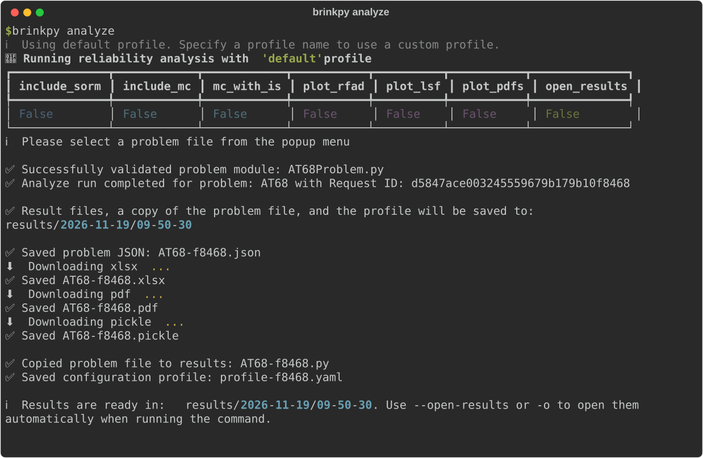

# CLI Basics for Brinkpy Users

This page is for users who are new to command-line tools.

!!! note "Prerequisites"
    You need Python 3.10 or newer and a working terminal. An IDE is optional but recommended for editing problem files, especially if you are new to Python. If you are starting from scratch, see the [Getting Started with Python in VS Code](https://code.visualstudio.com/docs/python/python-tutorial) guide.

## What Is a CLI?

A command-line interface (CLI) lets you run software by typing commands in a terminal.

To run an analysis, design, or simulation with Brinkpy, the pattern is:

```text
brinkpy <command> <profile> [options]
```

Replace the parts in `< >` with your own values. Parts in `[ ]` are optional. A profile is a named settings file, and Brinkpy includes a built-in one called `default`.

Example:

```bash
brinkpy analyze default --include-sorm --plot-rfad
```

## First-Run Checklist

1. Create a project folder and move into it:

    ```bash
    mkdir brinkpy-work
    cd brinkpy-work
    ```

    Brinkpy reads and writes its `problems/`, `profiles/`, and `results/` folders in the folder you run it from, so always run it from your project folder.

2. Install Brinkpy:

    ```bash
    pip install brinkpy
    ```

3. Confirm the CLI is available:

    ```bash
    brinkpy --help
    ```

4. Copy packaged example problems:

    ```bash
    brinkpy examples cp
    ```

5. Run a first analysis and select one of the example problems from the file picker:

    ```bash
    brinkpy analyze
    ```

    The first time you run an analysis, Brinkpy asks you to sign in through your browser.

## What the Terminal Shows

The `analyze`, `design`, and `simulate` commands print the same kind of output while they run. This is a first analysis with the `default` profile and the packaged `AT68Problem.py`:



From top to bottom:

1. **Profile notice.** Shown only with the `default` profile, as a reminder that you can name a profile of your own (see [Profiles](../profiles/index.md)).
2. **Command and profile.** The command that runs and the profile it uses.
3. **Options table.** The command options of this run: `True` for each option that is on, `False` for the others. These options come from the command line, not from the profile. When an option needs another one, Brinkpy turns the other one on, prints a warning above the table, and shows it as `True`. The columns depend on the command (see [Analyze](analyze.md#terminal-output), [Design](design.md#terminal-output), and [Simulate](simulate.md#terminal-output)).
4. **Sign-in.** On your first run, Brinkpy asks you to sign in through your browser. Later, when your sign-in has expired, it prints `Refreshing access token...` and renews it.
5. **Problem file.** A file picker opens in the `problems/` folder. If the folder has no problem files, or you close the picker without choosing one, Brinkpy stops with a message.
6. **Validated problem module.** Before sending the problem, Brinkpy loads the module and calls its `Problem()` function. If that fails, the message points to the line of your module that caused the error, and nothing is sent.
7. **Processing.** While the problem runs, a spinner shows `Processing AT68Problem.py...`. It disappears when the run finishes, so it isn't in the picture above.
8. **Run completed.** The problem name and the request ID of the run. The last five characters of the request ID end the names of the result files. Include the request ID when you contact support about a run.
9. **Results folder.** The timestamped folder in `results/` where the files are saved.
10. **Saved and downloaded files.** The problem JSON file, then the files downloaded from Brinkpy: the Excel workbook, and the PDF and pickle files when the run produced figures. A run without figures, such as a design without plots, has no PDF or pickle file. See [Result Files](results-files.md).
11. **Copied problem file and profile.** The copies of your problem module and of the profile, kept with the results.
12. **Results are ready.** Shown when you didn't use `--open-results` (`-o`). With `-o`, Brinkpy opens the Excel and PDF files instead, and shows the plots until you press Enter.

If the run fails, Brinkpy prints an error message instead of the lines after the failure and stops.

## Understanding Outputs

Brinkpy saves run outputs in timestamped folders inside `results/` in your project folder.

See [Result Files](results-files.md) for path and filename patterns. To reopen the plots of an earlier run, use `brinkpy plots` (see [Opening Saved Plots](results-files.md#opening-saved-plots)).

## Useful Help Commands

```bash
brinkpy --help
brinkpy analyze --help
brinkpy design --help
brinkpy simulate --help
brinkpy profile --help
```

## Common Beginner Tips

- Use `cd <folder>` to move into your project folder before running commands.
- Start with packaged examples before editing your own problem modules.
- If a command fails, run `brinkpy --help` or `brinkpy <command> --help` and verify the options you entered.
