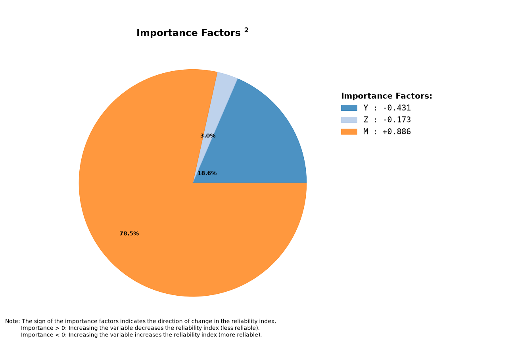

# Analyze Example: AT610 (FORM Only)

This page documents a basic `analyze` run without SORM or Monte Carlo.

!!! note "About the tables on this page"
    - Table values are rounded to 4 significant figures for readability. Very small/large values use scientific notation. Refer to the Excel/JSON result files for full precision.
    - Advanced solver diagnostics (for example `lsf_mult` and bound multipliers) are included in the Excel/JSON outputs.

## Run Context

Problem module:

- `problems/AT610Problem.py`

Recorded result set:

- `results/2026-11-04/22-29-07/AT610-58ff5.xlsx`
- `results/2026-11-04/22-29-07/AT610-58ff5.json`
- `results/2026-11-04/22-29-07/AT610-58ff5.py`
- `results/2026-11-04/22-29-07/AT610-58ff5.pickle`
- `results/2026-11-04/22-29-07/AT610-58ff5.pdf`
- `results/2026-11-04/22-29-07/profile-58ff5.yaml`

Profile and run mode from saved profile:

- Profile used: `default`
- `run_type: analyze`
- `include_sorm: false`
- `include_mc: false`
- `mc_with_is: false`

For results-folder and filename conventions, see [CLI Result Files](../../cli/results-files.md).

Equivalent command:

```bash
brinkpy analyze
```

## Profile Customization

This example uses the `default` profile. FORM behavior can be adjusted in a custom profile through `reliability_options.form_xtol`, `form_gtol`, `form_maxiter`, and `form_random_start`. See [FORM and Inverse FORM Settings](../../profiles/profile-reference.md#form-and-inverse-form-settings).

## Problem File Used

**Source:** Ang, A. H-S. and Tang, W. H., *Probability Concepts in Engineering Planning and Design, Vol. II*, Wiley, 1990, p. 368, Problem 6.10.

`AT610Problem.py` defines:

- Stochastic variables: `Y`, `Z`, `M`
- Distributions: `lognormal`, `lognormal`, `gumbelmax`
- Correlation: `corr(Y, Z) = 0.4`
- Limit state:
  - `R = Y * Z`
  - `L = M`
  - `g = R - L`

!!! note "Comparison with the book"
    Brinkpy's results differ slightly from the book's. The book applies the correlation coefficient directly in standard normal space, while Brinkpy adjusts it with the Nataf transformation, which is more accurate for correlated non-normal variables. See [Verification](../../why-brinkpy.md#verification).

## Extracted Results Worksheet Tables

The tables below are transcribed from the `Results` worksheet in `AT610-58ff5.xlsx`. For the meaning of each column, see [Results Tables Reference](../results-tables.md#form).

### Header Information

| Field | Value |
|---|---|
| Problem | `AT610` |
| Request ID | `59bf3ac3d4b7459c94862f4256758ff5` |
| Run time | `00 min 00.05 sec` |

### FORM Results

| beta | pf | beta_count | hbeta_count | lsf_count | glsf_count | hlsf_count | nit | min_tries | min_method | lsf_mult |
|---:|---:|---:|---:|---:|---:|---:|---:|---:|---|---:|
| 2.6644 | 0.0038566 | 6 | 6 | 6 | 6 | 6 | 6 | 1 | equality_constrained_sqp | 0.01110 |

### Stochastic Variable Inputs and FORM Failure Point Outputs

| var_name | var_type | mean | std | x | u | alpha | importance |
|---|---|---:|---:|---:|---:|---:|---:|
| Y | LogNormal | 40 | 5 | 33.7834 | -1.2943 | -0.4858 | -0.4307 |
| Z | LogNormal | 50 | 2.5 | 47.7542 | -0.4098 | -0.1538 | -0.1728 |
| M | GumbelMax | 1000 | 200 | 1613.2985 | 2.2926 | 0.8605 | 0.8858 |

### Correlations

| var 1 | var 2 | cor_x | cor_z |
|---|---|---:|---:|
| Y | Z | 0.4 | 0.4013 |

### Notes Reported by Brinkpy

1. Validation: Stochastic variables definition and limit state function validation required 2 function calls.
2. Validation: Validation of the limit state function's analytic gradient and Hessian required 31 function calls.

Brinkpy reports no note about active bounds because the problem does not define bounds for any variable. See [Bounds and Truncation](../index.md#bounds-and-truncation).

## Interpretation Snapshot

- This run isolates FORM behavior (no SORM, no Monte Carlo), which is useful for quick reliability screening.
- The reliability index is `beta = 2.6644` with `pf = 3.8566e-03`.
- The failure point importance ranking is dominated by `M`, then `Y`, then `Z`.

## Generated Figures

The PDF result file for this run is saved as `results/2026-11-04/22-29-07/AT610-58ff5.pdf`.

### Figure 1: Importance Factors


