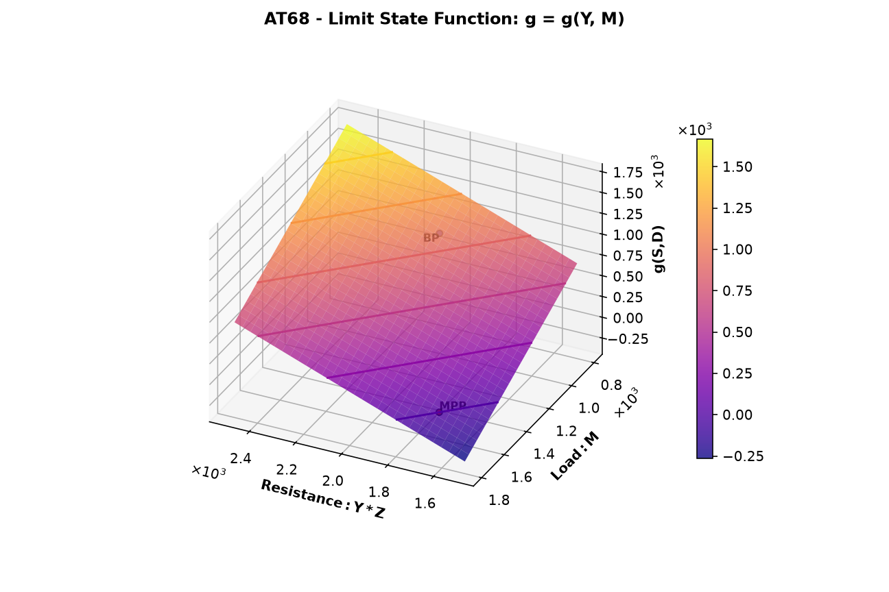
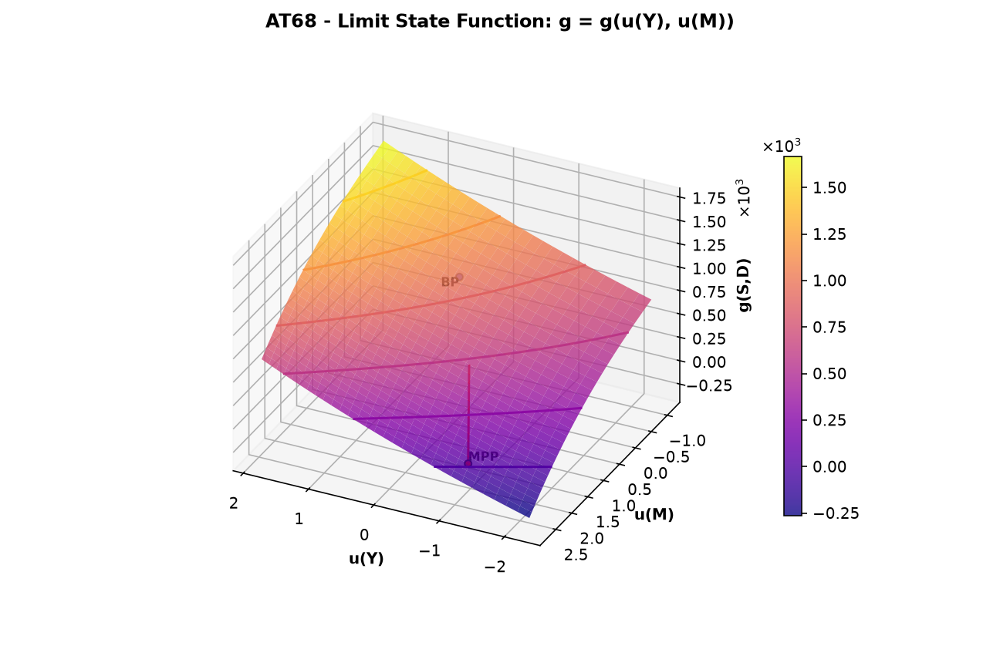

# Plot Example: AT68 (Limit State Function)

This page shows how to plot the limit state function over two stochastic variables and how to read the plots. Brinkpy has no separate plotting command, so the plots come from an `analyze` or `simulate` run with the `--plot-lsf` (`-l`) flag. This page covers only the plots. For the reliability results of an `analyze` run, see [FORM Only](../analyze/form-only.md).

## How to Generate the Plots

Add an `LSFplot` block to the problem file (see [`LSFplot`](../index.md#lsfplot)), then add `--plot-lsf` (`-l`) to an `analyze` or `simulate` command:

```bash
brinkpy analyze -l
```

```bash
brinkpy simulate -l
```

Brinkpy draws two plots of the same limit state function: one in the original variable space (x-space) and one in standard normal space (u-space).

`analyze` always runs FORM, so the plots also mark the failure point, also called the most probable point (MPP). With `simulate`, Brinkpy turns on FORM automatically when `plot_failure_point` is `true` in the profile (the default).

## Run Context

Problem module:

- `problems/AT68Problem.py`

Recorded result set:

- `results/2026-11-03/18-38-38/AT68-1bd88.xlsx`
- `results/2026-11-03/18-38-38/AT68-1bd88.json`
- `results/2026-11-03/18-38-38/AT68-1bd88.py`
- `results/2026-11-03/18-38-38/AT68-1bd88.pickle`
- `results/2026-11-03/18-38-38/AT68-1bd88.pdf`
- `results/2026-11-03/18-38-38/profile-1bd88.yaml`

Profile and run mode from saved profile:

- Profile used: `default`
- `run_type: analyze`
- `plot_lsf: true`

For results-folder and filename conventions, see [CLI Result Files](../../cli/results-files.md).

Equivalent command:

```bash
brinkpy analyze -l
```

## Problem File Used

**Source:** Ang, A. H-S. and Tang, W. H., *Probability Concepts in Engineering Planning and Design, Vol. II*, Wiley, 1990, p. 363, Problem 6.8.

`AT68Problem.py` defines three uncorrelated stochastic variables, `Y` and `Z` (lognormal) and `M` (Gumbel maximum). The limit state function is `g = Y * Z - M`, with resistance `R = Y * Z` and load `L = M`. See [Probability Density Functions](probability-density-functions.md#problem-file-used) for the full definition.

The `LSFplot` block puts the resistance on the x axis and the load on the y axis:

```python
"LSFplot": {
    "x_var": "Y",
    "x_lim": [30.0, 50.0],
    "x_func": lambda S, D: S[0] * S[1],
    "x_label": "Resistance: Y*Z",
    "y_var": "M",
    "y_lim": [800, 1800],
    "y_func": lambda S, D: S[2],
    "y_label": "Load: M",
},
```

Brinkpy varies `x_var` (`Y`) over `x_lim` and `y_var` (`M`) over `y_lim`, and holds every other stochastic variable (here `Z`) at its mean. `x_func` and `y_func` change only what the axes show: the x axis shows `Y * Z` instead of `Y`. Because `z_var` is omitted, the z axis shows the value of the limit state function, `g(S,D)`.

## How to Read the Plots

- **Surface:** the value of the limit state function over the plot window, colored by its value. The lines on the surface are contour lines of constant `g`.
- **BP (base point):** the point where every stochastic variable is at its mean.
- **MPP (most probable point):** the FORM failure point. It lies on the limit state surface, so Brinkpy draws it at `g = 0`.
- **Axis limits:** Brinkpy widens the axes when needed so that the base point and the MPP are visible, even when they fall outside `x_lim` and `y_lim`.

## Generated Figures

The PDF result file for this run is saved as `results/2026-11-03/18-38-38/AT68-1bd88.pdf`. Because `analyze` always runs FORM, the file starts with the importance factors plot as Figure 1 (see [FORM Only](../analyze/form-only.md#figure-1-importance-factors)). The limit state function plots follow as Figures 2 and 3.

### Figure 2: Limit State Function in x-space



The x axis shows the resistance `Y * Z` from 1500 to 2500, that is, `Y` from 30 to 50 times `Z = 50`. The y axis shows the load `M`. Because `g = Y * Z - M`, the surface is a plane that rises with resistance and falls with load.

The base point is at `Y * Z = 2000` and `M = 1000`, where `g = 1000`. Over this window, `g` runs from 1700 down to −300, so the surface crosses into the failure region `g ≤ 0` in the corner with low resistance and high load. The contour lines are drawn every 300, so the darkest line, which passes near the MPP, is `g = 0`, the limit state surface.

The MPP is at `Y * Z = 1673` and `M = 1673`, where resistance equals load. `y_lim` extends to 1800 so that the plot window includes the MPP and the failure region around it. When you choose `x_lim` and `y_lim` for your own problem, include the MPP, or the surface may not reach `g = 0` at all.

The MPP is drawn at `g = 0` but sits slightly below the surface. The surface holds `Z` at its mean of 50, while at the MPP `Z = 48.78`. With `Z = 50`, the surface at that point has `g = 42`.

### Figure 3: Limit State Function in u-space



The same limit state function, plotted over the standard normal variables `u(Y)` and `u(M)`. The u-space plot always uses `x_var` and `y_var` directly, so `x_func` and `y_func` do not apply. The window `Y` from 30 to 50 becomes `u(Y)` from −2.25 to 1.85.

- The transformation to u-space is nonlinear, so the contour lines curve, although the surface is a plane in x-space.
- The base point is not at the origin, at `u(Y) = 0.06` and `u(M) = 0.18`. The origin of u-space corresponds to the median of each variable, and the mean of a lognormal or a Gumbel maximum variable is larger than its median.
- The surface crosses `g = 0` near the MPP, in the corner with low `u(Y)` and high `u(M)`.
- The red line runs from the origin to the MPP at `u(Y) = −1.17` and `u(M) = 2.43`. It is the part of the FORM reliability vector in the `u(Y)` and `u(M)` plane. Its length is 2.70, a little shorter than `β = 2.742` because the MPP also has `u(Z) = −0.47`.

## Profile Options

The `lsf_plot_options` section of the profile controls how the plots are drawn. This run uses the defaults:

```yaml
lsf_plot_options:
  n_x_points: 30
  n_y_points: 29
  plot_base_point: true
  plot_failure_point: true
  with_labels: true
  ignore_axis_funcs: false
  view: auto
  cmap: plasma
  type: surface
```

| Option | What to change it for |
|---|---|
| `n_x_points`, `n_y_points` | A finer or coarser grid. More points give a smoother surface but take more limit state function evaluations. |
| `plot_base_point` | Hide the base point with `false`. |
| `plot_failure_point` | Hide the MPP and the red line with `false`. With `simulate`, this also stops Brinkpy from turning on FORM. |
| `with_labels` | Hide the `BP` and `MPP` labels with `false`. |
| `ignore_axis_funcs` | Plot `x_var` and `y_var` directly with `true`, ignoring `x_func` and `y_func`. In this example the x axis would show `Y` instead of `Y * Z`. |
| `view` | The viewing angle of the 3D plot. `auto` (the default) chooses the elevation and azimuth that best show the details of the figure. `default` uses the Matplotlib default view. `XY`, `XZ`, and `YZ` look straight at that plane, and the versions with a minus sign (for example `-XY`) look at it from the opposite side. A tuple sets the elevation, azimuth, and roll in degrees, for example `(30, 120, 0)`. |
| `cmap` | The colormap of the surface, as a Matplotlib colormap name. |
| `type` | `contour` to draw only the contour lines of `g`, still in a 3D plot, instead of the shaded surface. |

To change these options, create a custom profile and run it by name, for example `brinkpy analyze myprofile -l`. See [Profiles](../../profiles/index.md) and [LSF Plot Options](../../profiles/profile-reference.md#lsf-plot-options) for the allowed values.
