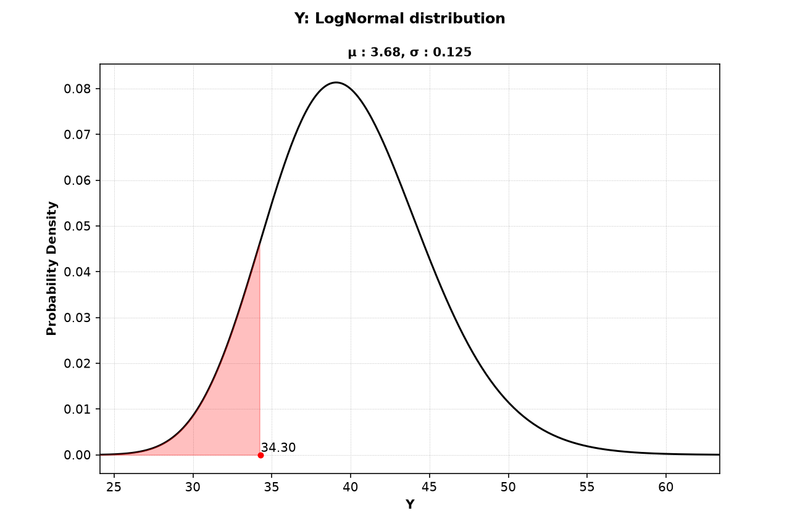
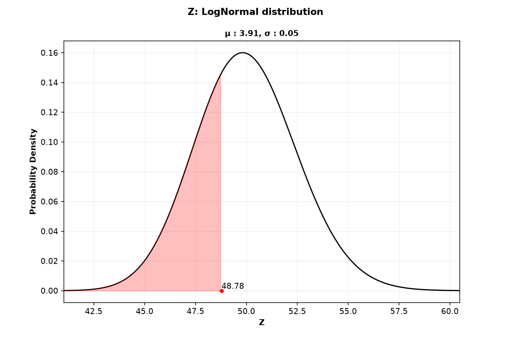
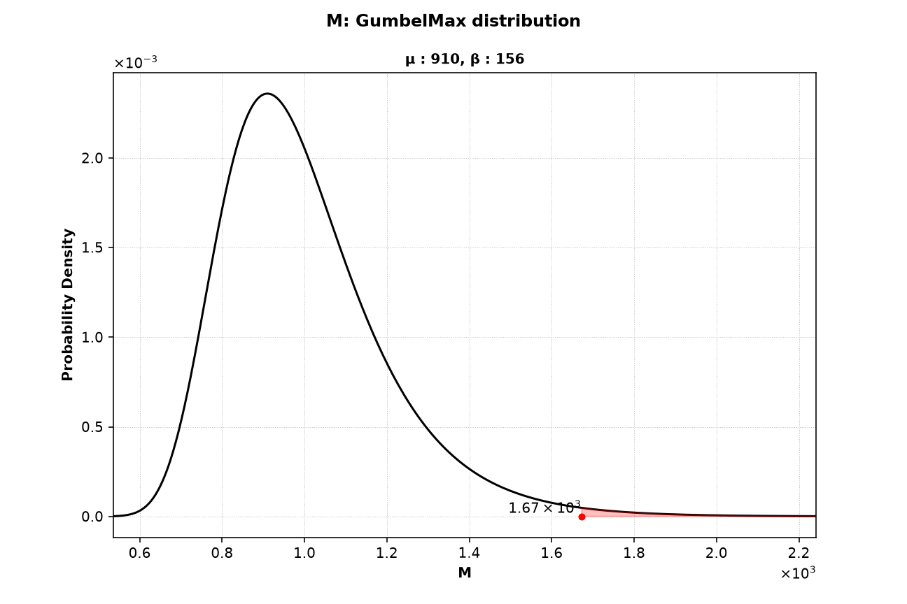

# Plot Example: AT68 (Probability Density Functions)

This page shows how to plot the probability density function of each stochastic variable and how to read the plots. Brinkpy has no separate plotting command, so the plots come from an `analyze` or `simulate` run with the `--plot-pdfs` (`-p`) flag. This page covers only the plots. For the reliability results of an `analyze` run, see [FORM Only](../analyze/form-only.md).

## How to Generate the Plots

Add `--plot-pdfs` (`-p`) to an `analyze` or `simulate` command:

```bash
brinkpy analyze -p
```

```bash
brinkpy simulate -p
```

Unlike the limit state function plot and the reliability-based failure assessment diagram (RFAD), these plots need no extra key in the problem file. Brinkpy plots every stochastic variable from its `StochasticVariables` definition.

`analyze` always runs FORM, so the plots also mark the failure point of each variable. With `simulate`, FORM runs only when you add `--include-form` (`-f`). Without FORM, there is no failure point to mark.

## Run Context

Problem module:

- `problems/AT68Problem.py`

Recorded result set:

- `results/2026-11-03/18-10-59/AT68-0c097.xlsx`
- `results/2026-11-03/18-10-59/AT68-0c097.json`
- `results/2026-11-03/18-10-59/AT68-0c097.py`
- `results/2026-11-03/18-10-59/AT68-0c097.pickle`
- `results/2026-11-03/18-10-59/AT68-0c097.pdf`
- `results/2026-11-03/18-10-59/profile-0c097.yaml`

Profile and run mode from saved profile:

- Profile used: `default`
- `run_type: analyze`
- `plot_pdfs: true`

For results-folder and filename conventions, see [CLI Result Files](../../cli/results-files.md).

Equivalent command:

```bash
brinkpy analyze -p
```

## Profile Customization

The profile has no options for these plots. The [Reporting Options](../../profiles/profile-reference.md#reporting-options) `save_plots_to_pdf` and `save_plots_to_pickle` control whether the plots are saved to the PDF result file and the pickle file.

## Problem File Used

**Source:** Ang, A. H-S. and Tang, W. H., *Probability Concepts in Engineering Planning and Design, Vol. II*, Wiley, 1990, p. 363, Problem 6.8.

`AT68Problem.py` defines three uncorrelated stochastic variables:

```python
"StochasticVariables": {
    "name": ["Y", "Z", "M"],
    "type": ["lognormal", "lognormal", "gumbelmax"],
    "mean": [40, 50.0, 1000.0],
    "cv": [0.125, 0.05, 0.2],
},
```

The limit state function is `g = Y * Z - M`, with resistance `R = Y * Z` and load `L = M`.

## How to Read the Plots

Each figure shows one stochastic variable:

- **Title:** the variable name and its distribution.
- **Subtitle:** the distribution parameters (`param1` and `param2`), not the mean and standard deviation. For a `lognormal` variable they are the mean `μ` and standard deviation `σ` of the natural logarithm of the variable. For a `gumbelmax` variable they are the location `μ` and the scale `β`. Here `β` is the Gumbel scale parameter, not the reliability index. See [Supported Statistical Distributions](../index.md#supported-statistical-distributions) for the parameters of every distribution.
- **Black curve:** the probability density function.
- **Red dot and label:** the value of the variable at the FORM failure point (the `x` column of the FORM results).
- **Red shaded area:** the tail of the distribution beyond the failure point, on the side that leads toward failure. Its area is the probability that the variable alone falls beyond its failure point value.

The plots show each variable on its own. When variables are correlated, the plots do not show the correlation.

## Generated Figures

The PDF result file for this run is saved as `results/2026-11-03/18-10-59/AT68-0c097.pdf`. Because `analyze` always runs FORM, the file starts with the importance factors plot as Figure 1 (see [FORM Only](../analyze/form-only.md#figure-1-importance-factors)). The probability density functions follow as Figures 2 to 4.

### Figure 2: `Y` (Lognormal)



The subtitle values follow from the mean and coefficient of variation of `Y`: `σ = √ln(1 + 0.125²) = 0.1245` and `μ = ln(40) − σ²/2 = 3.681`. `Y` is part of the resistance, so failure lies toward small values and the lower tail is shaded. The failure point is `Y = 34.30`, and the shaded area is about 0.12.

### Figure 3: `Z` (Lognormal)



`Z` is also part of the resistance, so the lower tail is shaded. The failure point `Z = 48.78` is close to the mean of 50, so the shaded area is large, about 0.32. A large shaded area means the failure point value of the variable is not unusual.

### Figure 4: `M` (Gumbel Maximum)



`M` is the load, so failure lies toward large values and the upper tail is shaded. The failure point `M = 1673` is far in the upper tail, and the shaded area is only about 0.0075. The axes use scientific notation, shown by the `×10⁻³` and `×10³` labels at the ends of the axes.

## Interpretation Snapshot

- The shaded areas show where failure comes from. The failure point of `M` lies far in its upper tail, while the failure points of `Y` and `Z` lie close to their means. Failure is driven mainly by a large load, which matches the importance factors in Figure 1.
- A small shaded area means the variable must take an unusual value for failure to occur. Such variables are good candidates for a closer look at their distribution, because the result depends on the shape of their tail.
