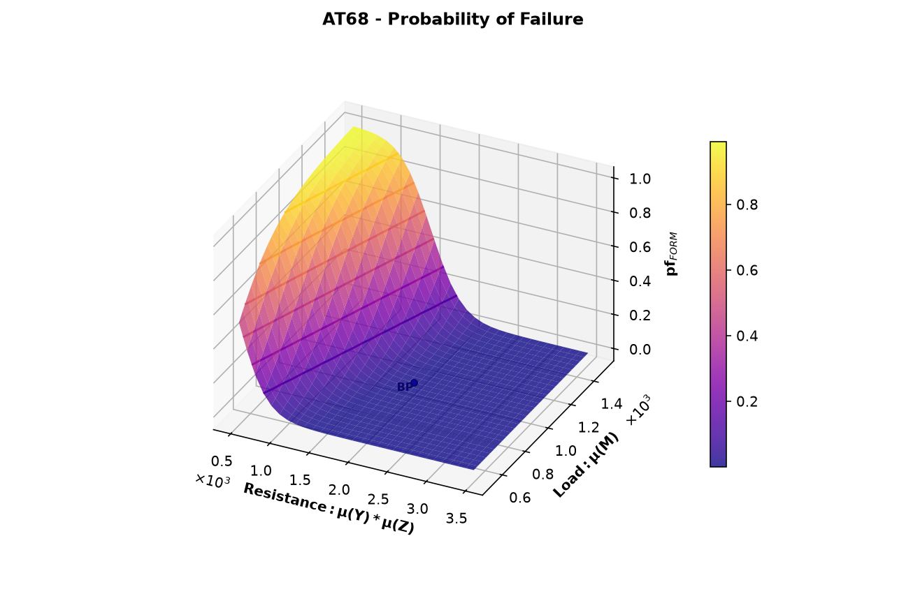
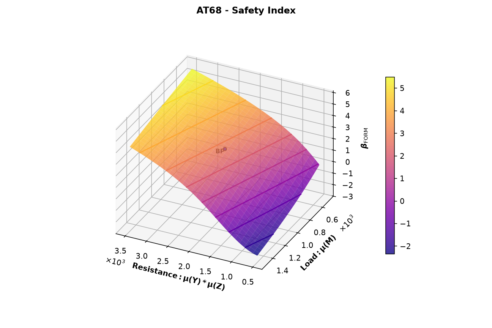
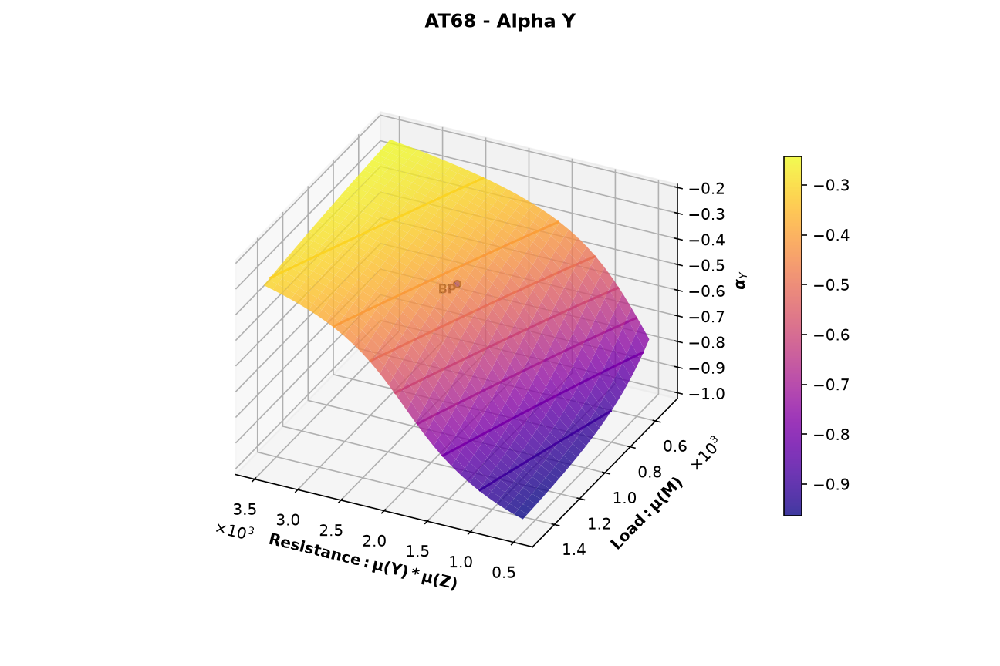
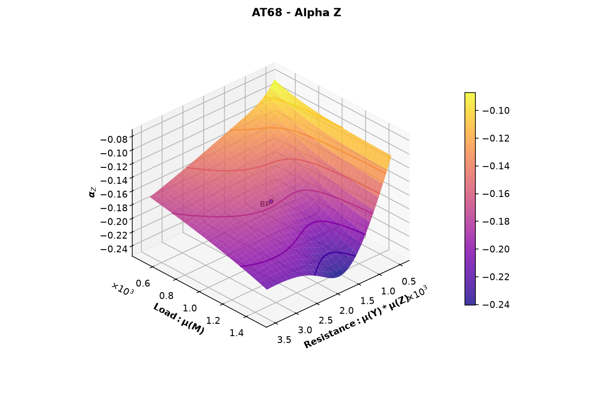
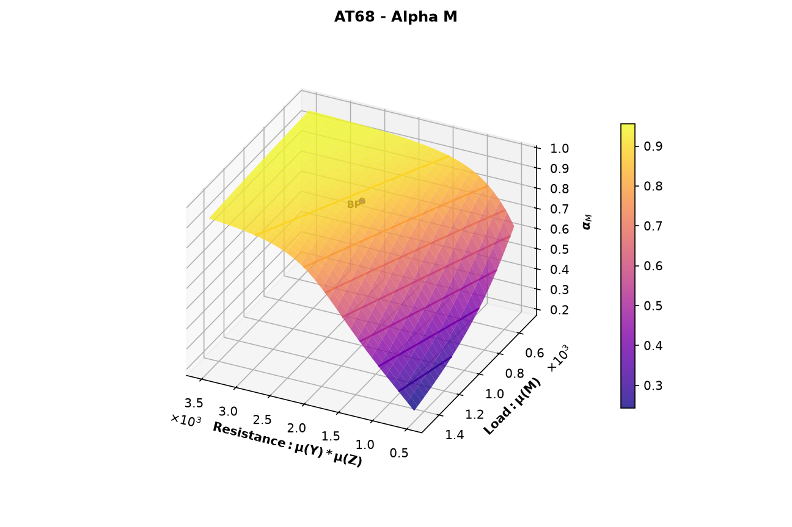

# Plot Example: AT68 (Reliability-Based Failure Assessment Diagram)

This page shows how to plot a reliability-based failure assessment diagram (RFAD) and how to read it. An RFAD shows how the reliability changes when the parameters of two stochastic variables change, for example the mean load and the mean resistance. Brinkpy has no separate plotting command, so the plots come from an `analyze` run with the `--plot-rfad` (`-r`) flag. This page covers only the plots. For the reliability results of an `analyze` run, see [FORM Only](../analyze/form-only.md).

## How to Generate the Plots

Add an `RFADplot` block to the problem file (see [`RFADplot`](../index.md#rfadplot)), then add `--plot-rfad` (`-r`) to an `analyze` command:

```bash
brinkpy analyze -r
```

The RFAD is available only with `analyze`. Brinkpy builds a grid over the two parameters and runs a FORM analysis at every grid point. It then plots the probability of failure, the reliability index, and the alpha value of each stochastic variable over the grid.

## Run Context

Problem module:

- `problems/AT68Problem.py`

Recorded result set:

- `results/2026-11-03/19-00-27/AT68-ecb10.xlsx`
- `results/2026-11-03/19-00-27/AT68-ecb10.json`
- `results/2026-11-03/19-00-27/AT68-ecb10.py`
- `results/2026-11-03/19-00-27/AT68-ecb10.pickle`
- `results/2026-11-03/19-00-27/AT68-ecb10.pdf`
- `results/2026-11-03/19-00-27/profile-ecb10.yaml`

Profile and run mode from saved profile:

- Profile used: `default`
- `run_type: analyze`
- `plot_rfad: true`

For results-folder and filename conventions, see [CLI Result Files](../../cli/results-files.md).

Equivalent command:

```bash
brinkpy analyze -r
```

## Problem File Used

**Source:** Ang, A. H-S. and Tang, W. H., *Probability Concepts in Engineering Planning and Design, Vol. II*, Wiley, 1990, p. 363, Problem 6.8.

`AT68Problem.py` defines three uncorrelated stochastic variables, `Y` and `Z` (lognormal) and `M` (Gumbel maximum). The limit state function is `g = Y * Z - M`, with resistance `R = Y * Z` and load `L = M`. See [Probability Density Functions](probability-density-functions.md#problem-file-used) for the full definition.

The `RFADplot` block sweeps the mean of `Y` on the x axis and the mean of `M` on the y axis:

```python
"RFADplot": {
    "x_var": "Y",
    "x_param": "mean",
    "x_lim": [10.0, 70.0],
    "x_func": lambda S, D: S[0] * S[1],
    "x_label": "Resistance: \\mu(Y)*\\mu(Z)",
    "y_var": "M",
    "y_param": "mean",
    "y_lim": [500.0, 1500.0],
    "y_func": lambda S, D: S[2],
    "y_label": "Load: \\mu(M)",
},
```

Brinkpy varies the mean of `Y` from 10 to 70 and the mean of `M` from 500 to 1500. Every other parameter keeps its value from `StochasticVariables`. `x_func` and `y_func` receive the means and change only what the axes show: the x axis shows the mean resistance `μ(Y) * μ(Z)`, from 500 to 3500, instead of `μ(Y)`.

!!! note "The standard deviation stays fixed"
    When Brinkpy changes the mean of a variable, it keeps the standard deviation, not the coefficient of variation. In this example the standard deviation of `Y` stays 5 and that of `M` stays 200 over the whole grid. At `μ(Y) = 10`, the coefficient of variation of `Y` is 0.5, while at `μ(Y) = 70` it is about 0.07.

    Changing one parameter at a time shows its effect on the reliability by itself. To study another parameter, set `x_param` or `y_param` to `"std"` (the standard deviation), `"param1"`, or `"param2"` (the distribution parameters listed in [Supported Statistical Distributions](../index.md#supported-statistical-distributions)).

With the default profile, the grid has 30 × 29 = 870 points, so this run made 870 FORM analyses. The run took about 5.4 seconds.

## How to Read the Plots

- **Surface:** the plotted quantity over the grid, colored by its value. The lines on the surface are contour lines of constant value.
- **BP (base point):** the means defined in `StochasticVariables`, here `μ(Y) * μ(Z) = 2000` and `μ(M) = 1000`. Its value matches the FORM result of a normal `analyze` run.
- **Views:** with `view: auto`, Brinkpy chooses the viewing angle for each figure, so the axes may point in different directions from one figure to the next. Check the axis labels before comparing figures.

## Generated Figures

The PDF result file for this run is saved as `results/2026-11-03/19-00-27/AT68-ecb10.pdf`. Because `analyze` always runs FORM, the file starts with the importance factors plot as Figure 1 (see [FORM Only](../analyze/form-only.md#figure-1-importance-factors)). The RFAD plots follow as Figures 2 to 6.

### Figure 2: Probability of Failure



The FORM probability of failure over the grid. It is close to zero for most of the grid and rises steeply toward 1 where the mean resistance is small and the mean load is large. At the base point, `pf = 0.0031`. Because most of the surface is nearly flat at zero, the reliability index in Figure 3 is easier to read.

### Figure 3: Reliability Index



The FORM reliability index over the grid, from −2.4 to 5.6. Brinkpy titles this figure "Safety Index". At the base point, `β = 2.742`. A negative `β` means that the mean point is already in the failure region, so the probability of failure is larger than 0.5.

The contour lines are lines of constant `β`, drawn at whole numbers. They answer design questions directly. For example, along `μ(M) = 1000` the `β = 3` contour crosses at a mean resistance of about 2130, that is, `μ(Y) ≈ 42.7`. To reach `β = 3` with a mean load of 1000, the mean of `Y` must be about 42.7 instead of 40.

### Figures 4 to 6: Alpha Values







One figure per stochastic variable shows its alpha value, the component of the unit vector from the origin to the failure point in standard normal space. With the default `alpha_direction: outward`, the resistance variables `Y` and `Z` have negative alpha values and the load `M` has positive values. At the base point, `α(Y) = −0.43`, `α(Z) = −0.17`, and `α(M) = 0.89`, the same values as in the importance factors plot. At every grid point, the squares of the alpha values add up to 1.

The alpha values show which variable controls the reliability in each part of the grid:

- Where the mean resistance is large and the mean load is small, `α(M)` is close to 1. The load controls the reliability.
- Where the mean resistance is small, `α(Y)` approaches −1 and `α(M)` drops to about 0.2. With its standard deviation fixed at 5, `Y` becomes relatively more uncertain as its mean drops, so it takes over.
- `α(Z)` stays small, between −0.24 and −0.08, over the whole grid. `Z` has the smallest coefficient of variation (0.05) and never controls the reliability.

## Profile Options

The `rfad_plot_options` section of the profile controls how the plots are drawn. This run uses the defaults:

```yaml
rfad_plot_options:
  n_x_points: 30
  n_y_points: 29
  plot_beta: true
  plot_alphas: true
  plot_base_point: true
  with_labels: true
  ignore_axis_funcs: false
  view: auto
  cmap: plasma
  type: surface
```

| Option | What to change it for |
|---|---|
| `n_x_points`, `n_y_points` | A finer or coarser grid. Brinkpy runs one FORM analysis per grid point (`n_x_points × n_y_points`), so the run time grows with the number of points. |
| `plot_beta` | Skip the reliability index plot (Figure 3) with `false`. |
| `plot_alphas` | Skip the alpha plots (Figures 4 to 6) with `false`. |
| `plot_base_point` | Hide the base point with `false`. |
| `with_labels` | Hide the `BP` label with `false`. |
| `ignore_axis_funcs` | Plot the swept parameters directly with `true`, ignoring `x_func` and `y_func`. In this example the x axis would show `μ(Y)` instead of `μ(Y) * μ(Z)`. |
| `view` | The viewing angle of the 3D plots. `auto` (the default) chooses the elevation and azimuth that best show the details of each figure. `default` uses the Matplotlib default view. `XY`, `XZ`, and `YZ` look straight at that plane, and the versions with a minus sign (for example `-XY`) look at it from the opposite side. A tuple sets the elevation, azimuth, and roll in degrees, for example `(30, 120, 0)`. With `XY`, the plots look like a classic contour map of the two parameters. |
| `cmap` | The colormap of the surfaces, as a Matplotlib colormap name. |
| `type` | `contour` to draw only the contour lines, still in a 3D plot, instead of the shaded surface. |

To change these options, create a custom profile and run it by name, for example `brinkpy analyze myprofile -r`. See [Profiles](../../profiles/index.md) and [RFAD Plot Options](../../profiles/profile-reference.md#rfad-plot-options) for the allowed values.
