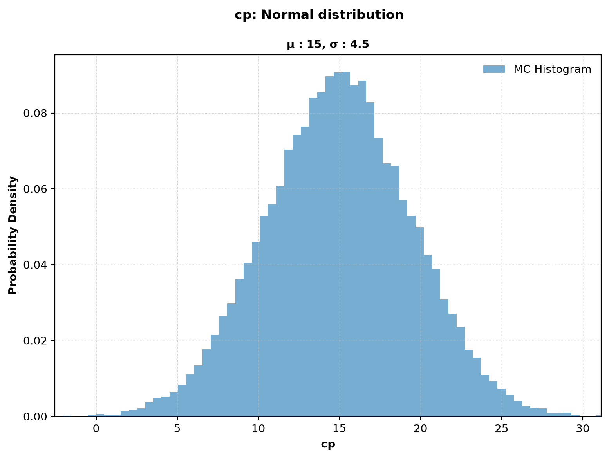
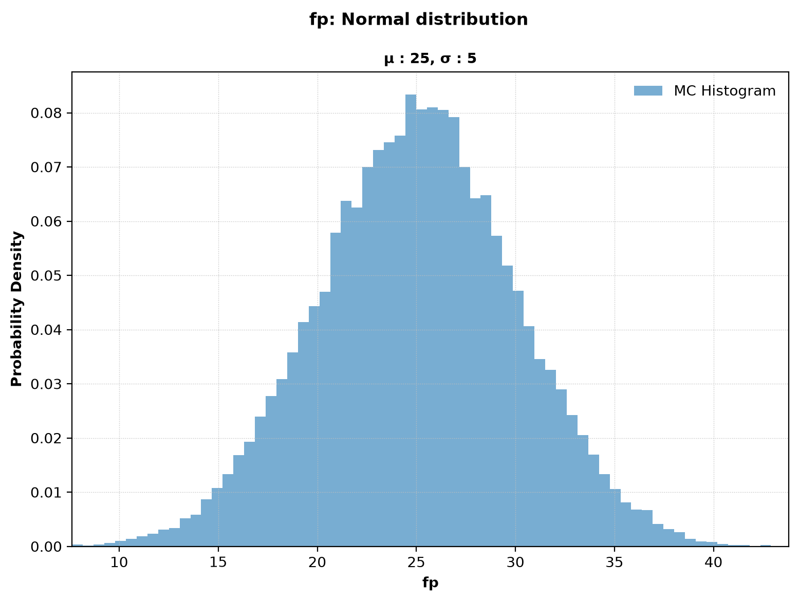
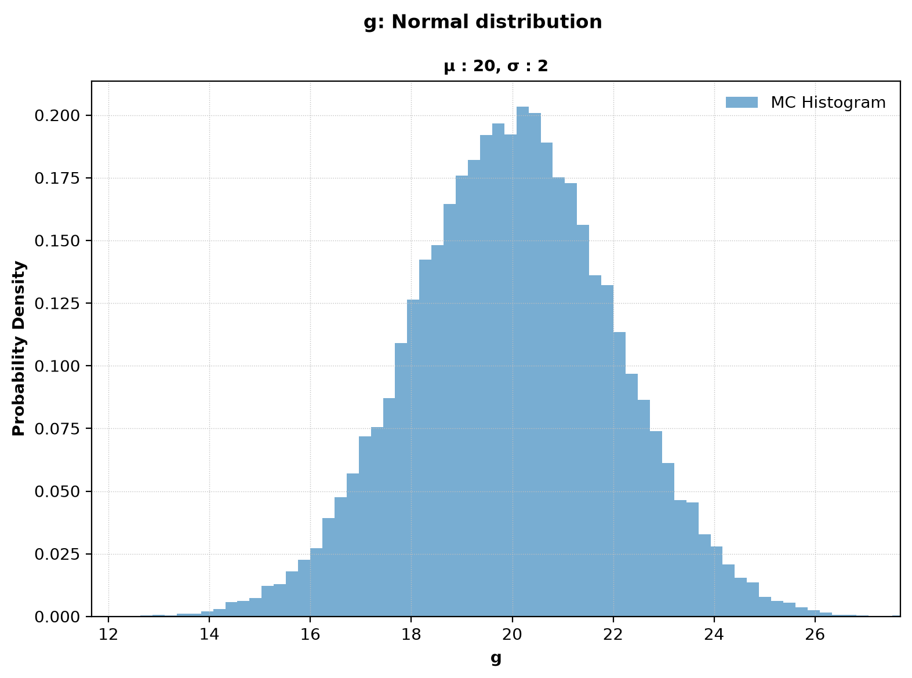
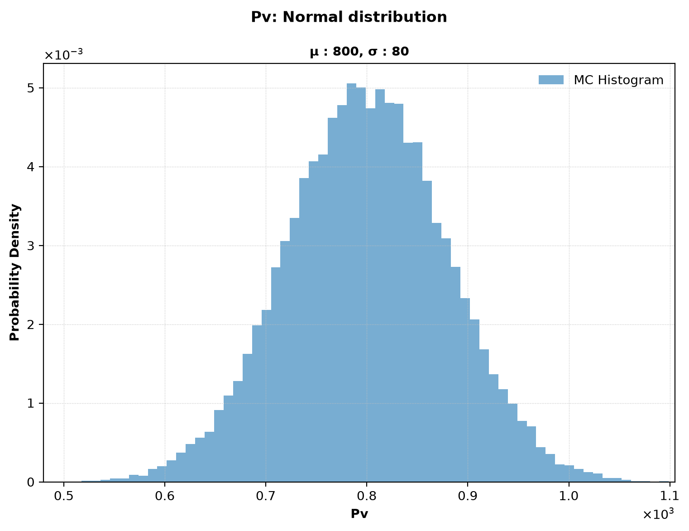
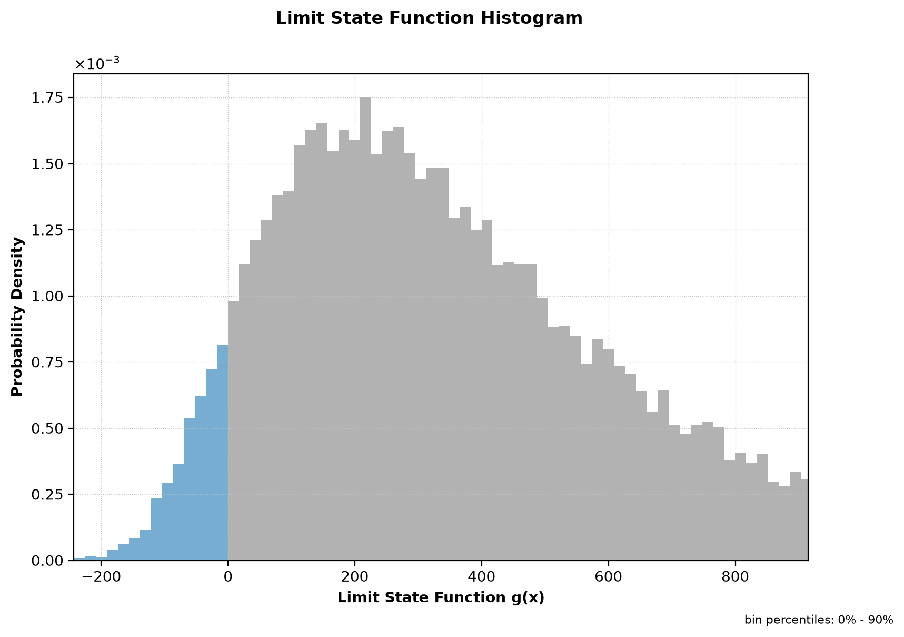
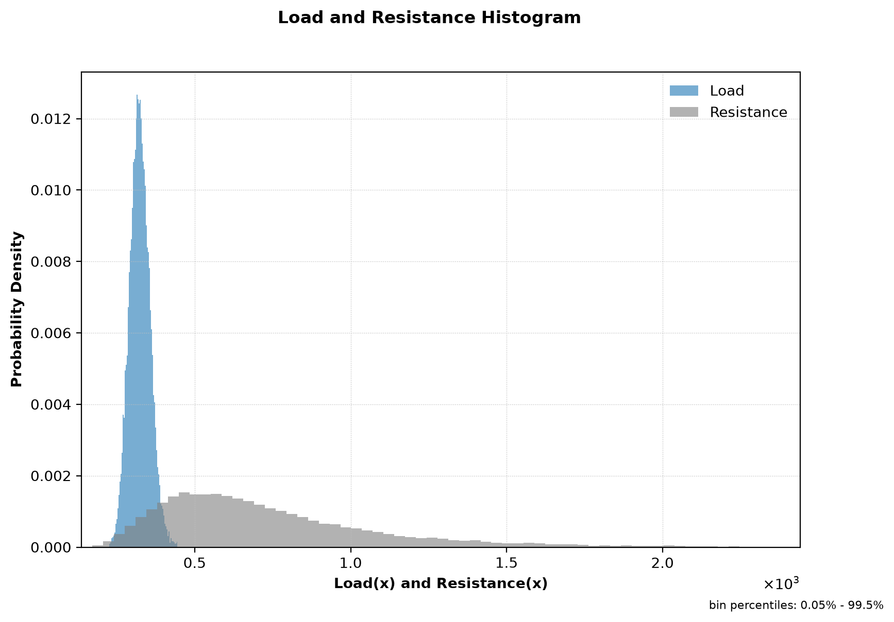

# Simulate Example: Chan2 (Classic Monte Carlo)

This page documents a simulate run in plain Monte Carlo mode (without importance sampling).

!!! note "About the tables on this page"
    - Table values are rounded to 4 significant figures for readability. Very small/large values use scientific notation. Refer to the Excel/JSON result files for full precision.

## Run Context

Problem module:

- `problems/Chan2Problem.py`

Recorded result set:

- `results/2026-11-17/20-36-47/Chan2-04cd2.xlsx`
- `results/2026-11-17/20-36-47/Chan2-04cd2.json`
- `results/2026-11-17/20-36-47/Chan2-04cd2.py`
- `results/2026-11-17/20-36-47/Chan2-04cd2.pickle`
- `results/2026-11-17/20-36-47/Chan2-04cd2.pdf`
- `results/2026-11-17/20-36-47/profile-04cd2.yaml`

Profile and run mode from saved profile:

- Profile used: `default`
- `run_type: simulate`
- `include_mc: true`
- `mc_with_is: false`

For results-folder and filename conventions, see [CLI Result Files](../../cli/results-files.md).

Equivalent command:

```bash
brinkpy simulate
```

The `simulate` command without `-i` runs plain (crude) Monte Carlo only.

## Profile Customization

This example uses the `default` profile. Monte Carlo behavior can be adjusted in a custom profile through `reliability_options.mc_n`, `mc_max_cv`, `mc_seed`, and `mc_remove_oob`. See [Monte Carlo Settings](../../profiles/profile-reference.md#monte-carlo-settings).

## Problem File Used

**Source:** Chan, C. L. and Low, B. K., "Practical second-order reliability analysis applied to foundation engineering," *International Journal for Numerical and Analytical Methods in Geomechanics*, 2012, vol. 36, no. 11, p. 1387–1409, Problem 2, p. 1397. [→](https://onlinelibrary.wiley.com/doi/full/10.1002/nag.1057)

`Chan2Problem.py` defines:

- Stochastic variables: `cp`, `fp`, `g`, `Ph`, `Pv` — all Normal
- Correlation: full 5 × 5 matrix defined using the `cor` key (see note below)
- Deterministic variables: `B = 5.0`, `L = 25.0`, `D = 1.8`, `h = 2.5`
- `LSFreturnsGradient: False`, `LSFreturnsHessian: False`, `LSFreturnsLandR: True`
- Limit state returns load ($P_v / B'$) and resistance (bearing-capacity formula)

!!! note "Using `cor` vs `cor_list`"
    `Chan2Problem.py` specifies the correlation matrix as a full **n × n list of lists** under the `cor` key.
    This is an alternative to `cor_list`, which accepts a list of `[var1, var2, value]` entries.
    If neither `cor` nor `cor_list` is supplied, Brinkpy assumes zero correlation for all variables.
    Either key may be used; the full matrix form is convenient when many off-diagonal correlations are non-zero.

```python
"StochasticVariables": {
    "name": ["cp", "fp", "g", "Ph", "Pv"],
    "type": ["normal", "normal", "normal", "normal", "normal"],
    "cor": [
        [1.0, -0.5,  0.0,  0.0, 0.0],
        [-0.5, 1.0,  0.5,  0.0, 0.0],
        [0.0,  0.5,  1.0,  0.0, 0.0],
        [0.0,  0.0,  0.0,  1.0, 0.5],
        [0.0,  0.0,  0.0,  0.5, 1.0],
    ],
    "mean": [15.0, 25.0, 20.0, 400.0, 800.0],
    "std":  [4.5,  5.0,  2.0,  40.0,  80.0],
},
```

Because `LSFreturnsLandR: True`, Brinkpy generates a **Load and Resistance Histogram** in addition to the per-variable and LSF histograms.

## Extracted Results Worksheet Tables

The tables below are transcribed from the `Results` worksheet in `Chan2-04cd2.xlsx`. For the meaning of each column, see [Results Tables Reference](../results-tables.md#monte-carlo).

### Header Information

| Field | Value |
|---|---|
| Problem | `Chan2` |
| Request ID | `134a2ed44d87475f8a545d2258a04cd2` |
| Run time | `00 min 00.49 sec` |

### Deterministic Variables

| var_name | value |
|---|---:|
| B | 5 |
| L | 25 |
| D | 1.8 |
| h | 2.5 |

### Stochastic Variables Definition

| var_name | var_type | mean | std | param1 | param2 |
|---|---|---:|---:|---:|---:|
| cp | Normal | 15 | 4.5 | 15 | 4.5 |
| fp | Normal | 25 | 5 | 25 | 5 |
| g | Normal | 20 | 2 | 20 | 2 |
| Ph | Normal | 400 | 40 | 400 | 40 |
| Pv | Normal | 800 | 80 | 800 | 80 |

### Monte Carlo Results

| beta | pf | cv | max_cv | size | %_removed | cycles | auto_size | mc_with_is |
|---:|---:|---:|---:|---:|---:|---:|---|---|
| 1.5426 | 0.06147 | 0.02256 | 0.05 | 30,000 | 0 | 3 | True | False |

### Monte Carlo Variable Statistics and Correlations

The sampled statistics confirm the input distributions and correlation structure.

| var_name | mean | std | %_oob | cor_x | cp | fp | g | Ph | Pv |
|---|---:|---:|---:|---|---:|---:|---:|---:|---:|
| cp | 14.9539 | 4.4972 | 0 | cp | 1.0000 | −0.5016 | −0.0056 | −0.0005 | −0.0105 |
| fp | 25.0458 | 4.9987 | 0 | fp | −0.5016 | 1.0000 | 0.5011 | −0.0051 | 0.0104 |
| g | 20.0136 | 2.0055 | 0 | g | −0.0056 | 0.5011 | 1.0000 | −0.0122 | 0.0002 |
| Ph | 399.854 | 39.929 | 0 | Ph | −0.0005 | −0.0051 | −0.0122 | 1.0000 | 0.4943 |
| Pv | 799.981 | 79.488 | 0 | Pv | −0.0105 | 0.0104 | 0.0002 | 0.4943 | 1.0000 |

### Notes Reported by Brinkpy

1. Validation: Stochastic variables definition and limit state function validation required 2 function calls.
2. Monte Carlo: Completed 3 cycles with `3.00e+04` samples in total, sizing each cycle from the pf estimated so far.

## Interpretation Snapshot

- `beta = 1.543`, `pf = 6.15%`: a relatively low reliability index for a bearing-capacity problem with correlated soil parameters.
- The coefficient of variation (`cv = 0.0226`) is below `max_cv = 0.05`. A `simulate` run has no FORM estimate of pf, so Brinkpy starts with 10,000 samples and sizes the next cycles from the pf estimated so far (note 2). A pf of about 6% needs only about 9,000 samples for the target, so the second and third cycles also use 10,000 samples, the least needed to reach the minimum of three cycles.
- The sampled correlations match the targets within the sampling error of 30,000 samples: `cor(cp, fp) ≈ −0.502`, `cor(fp, g) ≈ 0.501`, `cor(Ph, Pv) ≈ 0.494`.
- The limit state function returns NaN by design when `1 - Ph / (Pv + B'L'cp / tan(fp))` is not positive, in the inclination factors. This happens in about 1 of 100,000 samples, so this run had none. When it happens, Brinkpy reports the number of NaN values in a note and leaves those samples out of the statistics.

!!! note "Precision of the default settings"
    With the `default` profile, `mc_n` is `null` and `mc_max_cv` is 0.05, so Monte Carlo stops as soon as the coefficient of variation of pf is at most 0.05 and at least three cycles have run. For a more precise pf, set a smaller `mc_max_cv` in a custom profile. The number of samples grows with 1 / `mc_max_cv`², so halving `mc_max_cv` takes about four times as many samples. See [Monte Carlo Settings](../../profiles/profile-reference.md#monte-carlo-settings).

## Generated Figures

The PDF result file for this run is saved as `results/2026-11-17/20-36-47/Chan2-04cd2.pdf`.

### Figure 1: Monte Carlo Histogram — `cp`



### Figure 2: Monte Carlo Histogram — `fp`



### Figure 3: Monte Carlo Histogram — `g`



### Figure 4: Monte Carlo Histogram — `Ph`


### Figure 5: Monte Carlo Histogram — `Pv`



### Figure 6: Histogram of Limit State Function Values



### Figure 7: Load and Resistance Histogram

Generated because `LSFreturnsLandR: True` in the problem file.


