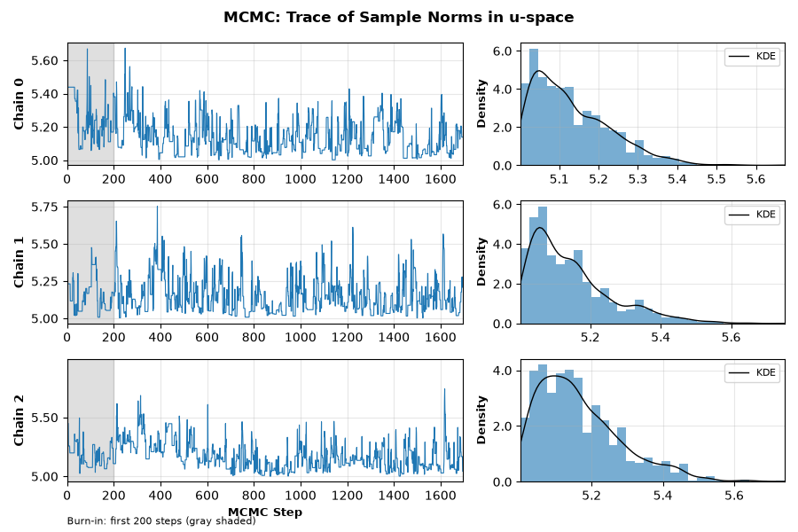
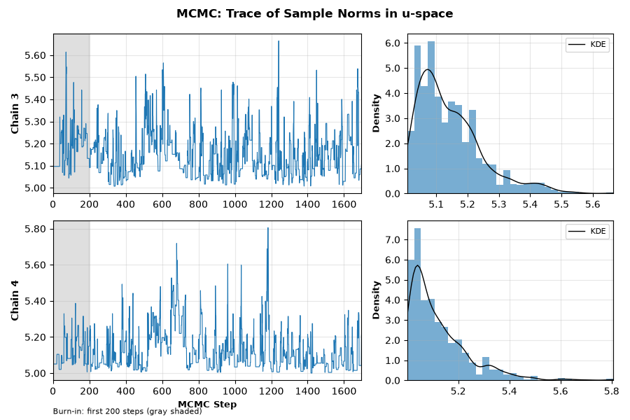
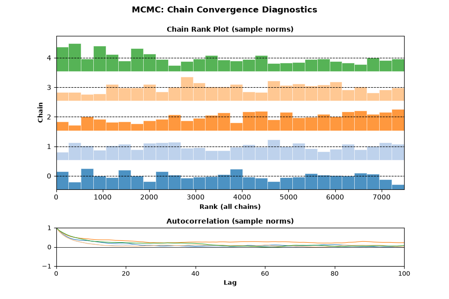
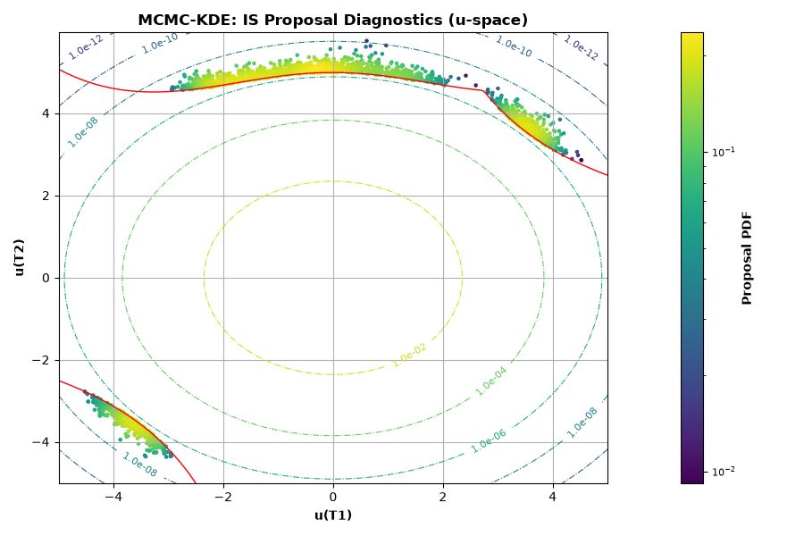
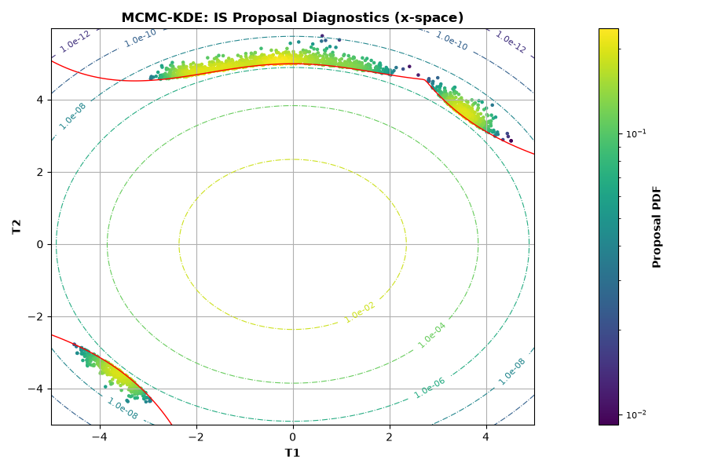
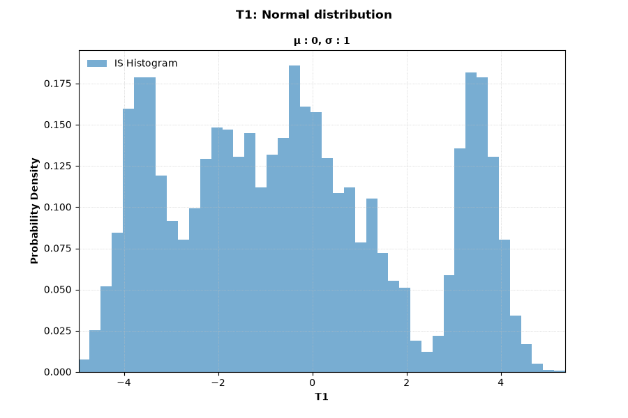
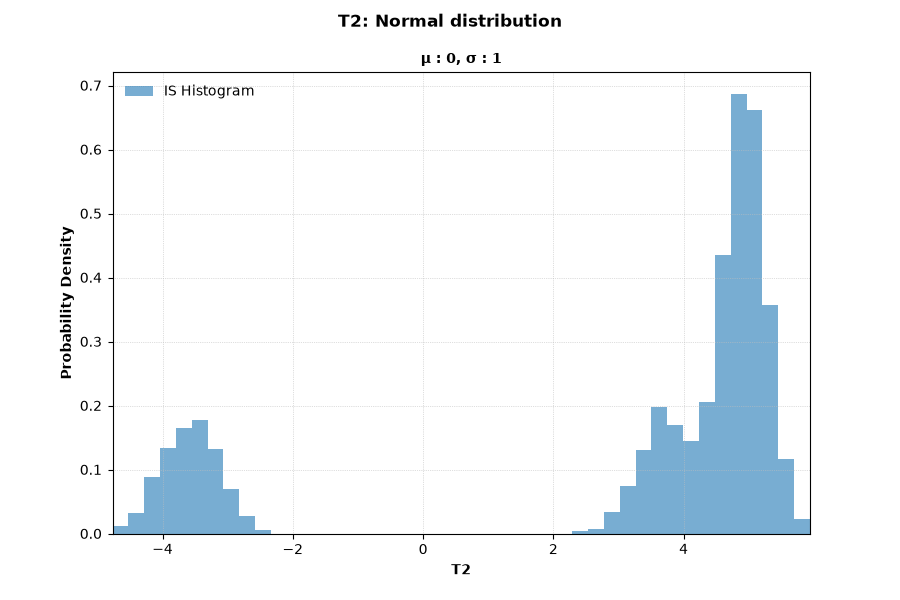
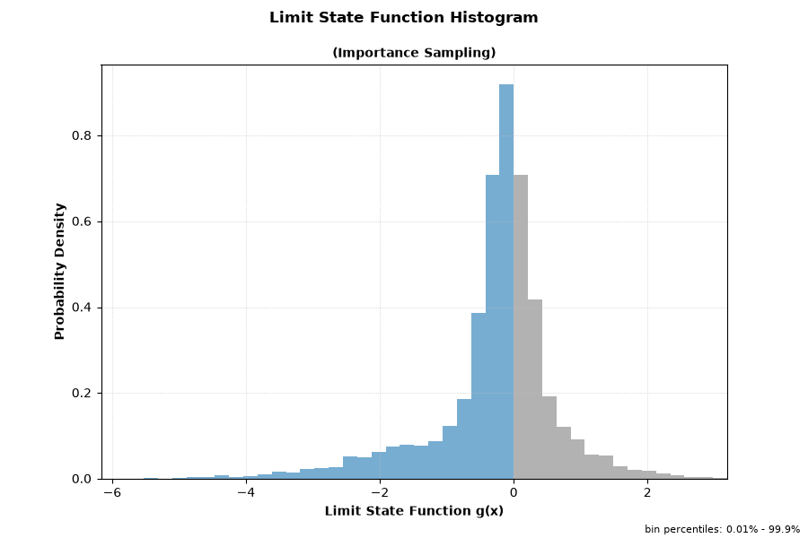

# Simulate Example: AU2 (MCMC Importance Sampling)

This page documents a simulate run with importance sampling (`-i`) where the proposal distribution is built with Markov chain Monte Carlo (MCMC). It uses the same problem as the [Importance Sampling](importance-sampling.md) example, which uses the default kernel density estimation (KDE) method, so the two runs can be compared directly.

!!! note "About the tables on this page"
    - Table values are rounded to 4 significant figures for readability. Very small/large values use scientific notation. Refer to the Excel/JSON result files for full precision.

## Run Context

Problem module:

- `problems/AU2Problem.py`

Recorded result set:

- `results/2026-11-02/18-50-21/AU2-b5cb6.xlsx`
- `results/2026-11-02/18-50-21/AU2-b5cb6.json`
- `results/2026-11-02/18-50-21/AU2-b5cb6.py`
- `results/2026-11-02/18-50-21/AU2-b5cb6.pickle`
- `results/2026-11-02/18-50-21/AU2-b5cb6.pdf`
- `results/2026-11-02/18-50-21/profile-b5cb6.yaml`

Profile and run mode from saved profile:

- Profile used: `custom`
- `run_type: simulate`
- `include_mc: true`
- `mc_with_is: true`
- `is_method: mcmc`

For results-folder and filename conventions, see [CLI Result Files](../../cli/results-files.md).

Equivalent command:

```bash
brinkpy simulate custom -i
```

## Profile Customization

The importance sampling method is set in the profile, not on the command line. This run uses a profile named `custom` with these importance sampling settings (the values for the MCMC options are the defaults):

```yaml
reliability_options:
  is_method: mcmc
  is_kde_bandwidth: scott
  is_mcmc_chains: 5
  is_mcmc_chain_length: 500
  is_mcmc_thinning: 3
  is_mcmc_burnin: 200
  is_mcmc_fit_method: kde
```

Each chain runs `is_mcmc_burnin + is_mcmc_chain_length × is_mcmc_thinning` steps, here 200 + 500 × 3 = 1,700 steps. Brinkpy discards the burn-in steps and keeps every third step after that, so each chain contributes 500 samples.

With `is_mcmc_fit_method: kde`, the MCMC samples are fitted with a KDE to form the proposal distribution, so `is_kde_bandwidth` also applies. To create and edit a profile, see [Profiles](../../profiles/index.md). For every option, see [Importance Sampling Settings](../../profiles/profile-reference.md#importance-sampling-settings) and [MCMC Importance Sampling Settings](../../profiles/profile-reference.md#mcmc-importance-sampling-settings).

## Problem File Used

This run uses `AU2Problem.py`, the series system of two limit state functions in two standard normal variables. See [Problem File Used](importance-sampling.md#problem-file-used) on the KDE example page for the definition and the `ISplot` key.

## Extracted Results Worksheet Tables

The tables below are transcribed from the `Results` worksheet in `AU2-b5cb6.xlsx`. For the meaning of each column, see [Results Tables Reference](../results-tables.md#monte-carlo).

### Header Information

| Field | Value |
|---|---|
| Problem | `AU2` |
| Request ID | `c7c05e6bdb394a4ea34eb5f8fa8b5cb6` |
| Run time | `00 min 01.29 sec` |

### Deterministic Variables

| var_name | value |
|---|---:|
| c | 5 |

### Stochastic Variables Definition

| var_name | var_type | mean | std | param1 | param2 |
|---|---|---:|---:|---:|---:|
| T1 | Normal | 0 | 1 | 0 | 1 |
| T2 | Normal | 0 | 1 | 0 | 1 |

### Monte Carlo Results (with Importance Sampling)

| beta | pf | cv | max_cv | size | %_removed | cycles | auto_size | mc_with_is | method | bandwidth | chains | length | burn_in | thinning |
|---:|---:|---:|---:|---:|---:|---:|---|---|---|---:|---:|---:|---:|---:|
| 4.7741 | 9.026e−7 | 0.01948 | 0.05 | 6,000 | 0 | 3 | True | True | mcmc+kde | 0.2714 | 5 | 500 | 200 | 3 |

The `method` value `mcmc+kde` combines the sampling method (`is_method`) and the fitting method (`is_mcmc_fit_method`). The columns `chains`, `length`, `burn_in`, and `thinning` appear only for MCMC runs.

### Monte Carlo Variable Statistics and Correlations (Proposal Samples)

!!! warning "Statistics describe the proposal samples"
    As with any importance sampling run, these statistics describe the samples drawn from the proposal distribution, not the original input distributions. The histograms in **Figures 6 and 7** also show the proposal samples.

| var_name | mean | std | %_oob | cor_x | T1 | T2 |
|---|---:|---:|---:|---|---:|---:|
| T1 | −0.3825 | 2.5302 | 0 | T1 | 1.0000 | 0.5644 |
| T2 | 2.9297 | 3.3854 | 0 | T2 | 0.5644 | 1.0000 |

### MCMC Diagnostics

This table appears in the worksheet under **Importance sampling method-specific results (mcmc+kde)**. It summarizes the norm of the MCMC samples in standard normal space (u-space), that is, each sample's distance from the origin.

| mean | sd | eti89_lb | eti89_ub | ess_bulk | ess_tail | r_hat | mcse_mean | mcse_sd |
|---:|---:|---:|---:|---:|---:|---:|---:|---:|
| 5.1419 | 0.1119 | 5.0171 | 5.3561 | 170.4 | 426.4 | 1.024 | 0.008469 | 0.004258 |

For what each column means and how to use it, see [MCMC Diagnostics](../results-tables.md#mcmc-diagnostics).

### Notes Reported by Brinkpy

1. Validation: Stochastic variables definition and limit state function validation required 1 function call.
2. Monte Carlo: Creation of importance sampling proposal distribution required 8,660 calls to the limit state function.
3. Monte Carlo: Completed 3 cycles with `2.00e+03` samples per cycle.
4. Monte Carlo: Load and resistance histograms are not available since the limit state function does not return load and resistance values.

## Comparison with the KDE Run

| | KDE ([example](importance-sampling.md)) | MCMC (this page) |
|---|---:|---:|
| `beta` | 4.7702 | 4.7741 |
| `pf` | 9.201e−7 | 9.026e−7 |
| `cv` | 0.03124 | 0.01948 |
| Samples (`size`) | 6,000 | 6,000 |
| Limit state function calls to build the proposal | 109,973 | 8,660 |
| Run time | 2.96 sec | 1.29 sec |

Both methods estimate nearly the same probability of failure. For this problem, MCMC needed about 13 times fewer limit state function calls to build the proposal distribution. That matters most when each limit state function call is expensive.

## Interpretation Snapshot

- The probability of failure (`pf ≈ 9.03 × 10⁻⁷`, `beta ≈ 4.77`) agrees with the KDE run, and `cv = 0.0195` is well below `max_cv = 0.05`.
- The MCMC samples are used only to build the proposal distribution. The probability of failure comes from the weighted importance samples, and `cv` reports its precision. Chain convergence still matters: if the chains miss part of the failure region, the proposal distribution may not cover it.
- Brinkpy calculates `r_hat` but does not enforce a limit. Here `r_hat = 1.024`, above the 1.01 often recommended in the MCMC literature. **Figure 3** shows where it comes from: the rank bars of chain 2 rise from left to right instead of staying level, and its autocorrelation decays more slowly than that of the other chains. To improve convergence, increase `is_mcmc_chain_length`, `is_mcmc_burnin`, or `is_mcmc_chains` in the profile and run again.
- **Figures 4 and 5** show that the chains found all three parts of the failure region: the arc along the top (component 1) and the two branches in the upper-right and lower-left corners (component 2).

## Generated Figures

The PDF result file for this run is saved as `results/2026-11-02/18-50-21/AU2-b5cb6.pdf`.

### Figures 1 and 2: Trace of Sample Norms in u-space

Each row shows one chain. The left plot traces the norm of the chain's samples at each MCMC step, with the burn-in steps shaded gray. The right plot shows the distribution of the norms after burn-in. Well-mixed chains move up and down around a stable level, without long trends.





### Figure 3: Chain Convergence Diagnostics

The rank plot shows, for each chain, how its samples rank among the samples of all chains. When the chains have converged to the same distribution, the bars of every chain are roughly level. The autocorrelation plot shows how strongly each sample depends on earlier samples in the same chain. Faster decay toward zero means more independent information per sample, which gives a larger effective sample size (`ess_bulk`, `ess_tail`).



### Figure 4: IS Proposal Diagnostics (u-space)

The proposal samples in standard normal space, colored by the proposal probability density. The red curve is the limit state surface.



### Figure 5: IS Proposal Diagnostics (x-space)

The same proposal samples in the original variable space (`T1`, `T2`). Because both variables are standard normal, this figure matches Figure 4.



### Figure 6: IS Histogram — `T1`



### Figure 7: IS Histogram — `T2`



### Figure 8: Limit State Function Histogram (Importance Sampling)


