# Simulate Example: Dai 1 (MCMC Importance Sampling)

This page documents a simulate run with importance sampling (`-i`) where the proposal distribution is built with Markov chain Monte Carlo (MCMC). The failure region of this problem has four separate parts, which shows how to read the MCMC diagnostics when the chains sample different parts. A short section at the end runs the `AU2` problem from the [Importance Sampling](importance-sampling.md) example, whose failure region has parts at the same distance from the origin.

!!! note "About the tables on this page"
    - Table values are rounded to 4 significant figures for readability. Very small/large values use scientific notation. Refer to the Excel/JSON result files for full precision.

## Run Context

Problem module:

- `problems/Dai1Problem.py`

Recorded result set:

- `results/2026-11-18/19-28-40/Dai_1-c9a73.xlsx`
- `results/2026-11-18/19-28-40/Dai_1-c9a73.json`
- `results/2026-11-18/19-28-40/Dai_1-c9a73.py`
- `results/2026-11-18/19-28-40/Dai_1-c9a73.pickle`
- `results/2026-11-18/19-28-40/Dai_1-c9a73.pdf`
- `results/2026-11-18/19-28-40/profile-c9a73.yaml`

Profile and run mode from saved profile:

- Profile used: `custom`
- `run_type: simulate`
- `include_mc: true`
- `mc_with_is: true`
- `is_method: mcmc`

For results-folder and filename conventions, see [CLI Result Files](../../cli/results-files.md).

Equivalent command:

```bash
brinkpy simulate custom -i
```

## Profile Customization

The importance sampling method is set in the profile, not on the command line. This run uses a profile named `custom` with these importance sampling settings:

```yaml
reliability_options:
  is_method: mcmc
  is_kde_bandwidth: scott
  is_mcmc_chains: 8
  is_mcmc_chain_length: 500
  is_mcmc_thinning: 3
  is_mcmc_burnin: 200
  is_mcmc_fit_method: kde
```

Only `is_method` and `is_mcmc_chains` differ from the defaults. Each chain starts from a different point of the failure region and usually stays in the part where it starts. This problem has four parts, so the run uses eight chains instead of the default five, which makes it more likely that every part gets at least one chain. With five chains, test runs also found all four parts.

Each chain runs `is_mcmc_burnin + is_mcmc_chain_length × is_mcmc_thinning` steps, here 200 + 500 × 3 = 1,700 steps. Brinkpy discards the burn-in steps and keeps every third step after that, so each chain contributes 500 samples.

With `is_mcmc_fit_method: kde`, the MCMC samples are fitted with a kernel density estimation (KDE) to form the proposal distribution, so `is_kde_bandwidth` also applies. To create and edit a profile, see [Profiles](../../profiles/index.md). For every option, see [Importance Sampling Settings](../../profiles/profile-reference.md#importance-sampling-settings) and [MCMC Importance Sampling Settings](../../profiles/profile-reference.md#mcmc-importance-sampling-settings).

## Problem File Used

**Source:** Dai, H., Zhang, H., Rasmussen, K. J. R., and Wang, W., "Wavelet density-based adaptive importance sampling method," *Structural Safety*, vol. 52, 2015, pp. 161–169, Example 1. [→](https://doi.org/10.1016/j.strusafe.2014.02.003)

`Dai1Problem.py` defines:

- Stochastic variables: `X1`, `X2`, both standard normal (μ = 0, σ = 1)
- No deterministic variables
- `LSFisSmooth: False`, `LSFreturnsGradient: False`, `LSFreturnsHessian: False`, `LSFreturnsLandR: False`
- A series system of four components, combined with `numpy.minimum()`:

```python
g1 = 3 + (X1 - X2)**2/10 - (X1 + X2) / np.sqrt(2)
g2 = 3 + (X1 - X2)**2/10 + (X1 + X2) / np.sqrt(2)
g3 = X1 - X2 + 7 / np.sqrt(2)
g4 = X2 - X1 + 7 / np.sqrt(2)
g = np.minimum(np.minimum(g1, g2), np.minimum(g3, g4))
```

Each component fails in its own part of the failure region. Components 1 and 2 fail in two curved parts, each 3 from the origin. Components 3 and 4 fail in two straight bands, each 3.5 from the origin. For series systems, see [Series and Parallel Systems](../index.md#series-and-parallel-systems).

The problem also defines the `ISplot` key, which turns on the importance sampling proposal diagnostic figures (see [`ISplot`](../index.md#isplot)):

```python
"ISplot": {
    "x_var": "X1",
    "x_lim": [-8, 8],
    "y_var": "X2",
    "y_lim": [-8, 8],
},
```

## Extracted Results Worksheet Tables

The tables below are transcribed from the `Results` worksheet in `Dai_1-c9a73.xlsx`. For the meaning of each column, see [Results Tables Reference](../results-tables.md#monte-carlo).

### Header Information

| Field | Value |
|---|---|
| Problem | `Dai 1` |
| Request ID | `522419e5262046348c20e5cf39dc9a73` |
| Run time | `00 min 03.10 sec` |

### Stochastic Variables Definition

| var_name | var_type | mean | std | param1 | param2 |
|---|---|---:|---:|---:|---:|
| X1 | Normal | 0 | 1 | 0 | 1 |
| X2 | Normal | 0 | 1 | 0 | 1 |

### Monte Carlo Results (with Importance Sampling)

| beta | pf | cv | max_cv | size | %_removed | cycles | auto_size | mc_with_is | method | bandwidth | chains | length | burn_in | thinning |
|---:|---:|---:|---:|---:|---:|---:|---|---|---|---:|---:|---:|---:|---:|
| 2.8469 | 2.207e−3 | 0.01676 | 0.05 | 6,000 | 0 | 3 | True | True | mcmc+kde | 0.2510 | 8 | 500 | 200 | 3 |

The `method` value `mcmc+kde` combines the sampling method (`is_method`) and the fitting method (`is_mcmc_fit_method`). The columns `chains`, `length`, `burn_in`, and `thinning` appear only for MCMC runs.

### Monte Carlo Variable Statistics and Correlations (Proposal Samples)

!!! warning "Statistics describe the proposal samples"
    As with any importance sampling run, these statistics describe the samples drawn from the proposal distribution, not the original input distributions. The histograms in **Figures 9 and 10** also show the proposal samples.

| var_name | mean | std | %_oob | cor_x | X1 | X2 |
|---|---:|---:|---:|---|---:|---:|
| X1 | −0.1289 | 2.4131 | 0 | X1 | 1.0000 | −0.1085 |
| X2 | −0.03760 | 2.5136 | 0 | X2 | −0.1085 | 1.0000 |

### MCMC Diagnostics

This table appears in the worksheet under **Importance sampling method-specific results (mcmc+kde)**. It summarizes the norm of the MCMC samples in standard normal space (u-space), that is, each sample's distance from the origin.

| mean | sd | eti89_lb | eti89_ub | ess_bulk | ess_tail | r_hat | mcse_mean | mcse_sd |
|---:|---:|---:|---:|---:|---:|---:|---:|---:|
| 3.4590 | 0.2876 | 3.0481 | 3.9170 | 13.81 | 70.51 | 1.583 | 0.08392 | 0.005841 |

For what each column means and how to use it, see [MCMC Diagnostics](../results-tables.md#mcmc-diagnostics).

### Notes Reported by Brinkpy

1. Validation: Stochastic variables definition and limit state function validation required 2 function calls.
2. Monte Carlo: Creation of importance sampling proposal distribution required 13,703 calls to the limit state function.
3. Monte Carlo: Completed 3 cycles with `2.00e+03` samples per cycle.
4. Monte Carlo: Load and resistance histograms are not available since the limit state function does not return load and resistance values.

## Interpretation Snapshot

- The probability of failure is `pf ≈ 2.21 × 10⁻³` (`beta ≈ 2.85`), and `cv = 0.0168` is well below `max_cv = 0.05`. A classic Monte Carlo simulation of the same function with 10⁸ samples gives `pf ≈ 2.22 × 10⁻³`, within the precision that `cv` reports.
- **Figure 5** shows where each chain went. Every part of the failure region has two chains: chains 2 and 4 in the lower-left curved part, chains 3 and 5 in the upper-right curved part, chains 0 and 6 in the lower-right band, and chains 1 and 7 in the upper-left band.
- `r_hat = 1.583` is far above the 1.01 often recommended in the MCMC literature, and `ess_bulk` is only 14. Both come from the two distances: the chains in the curved parts stay near 3, and those in the bands near 3.5 (**Figures 1 to 3**). In the rank plot of **Figure 4**, chains 2 to 5 hold all the low ranks and the other chains all the high ranks.
- Each chain mixes well within its part: its trace moves around a stable level without trends, and its autocorrelation decays quickly (**Figure 4**). Longer chains would not lower `r_hat`, because the chains would still sample different parts.
- A high `r_hat` from separate parts does not make the result wrong. The MCMC samples only build the proposal distribution, and `cv` measures the precision of the probability of failure (see [MCMC Diagnostics](../results-tables.md#mcmc-diagnostics)).
- The proposal distribution weights the samples of every chain equally, so each part gets a share of the proposal in proportion to its number of chains. The curved parts hold about 80% of the probability of failure, and here they have half of the chains. In runs where fewer chains reach them, the proposal places fewer samples there and `cv` tends to be larger. The importance sampling weights keep the estimate correct either way.

## Generated Figures

The PDF result file for this run is saved as `results/2026-11-18/19-28-40/Dai_1-c9a73.pdf`.

### Figures 1 to 3: Trace of Sample Norms in u-space

Each row shows one chain. The left plot traces the norm of the chain's samples at each MCMC step, with the burn-in steps shaded gray. The right plot shows the distribution of the norms after burn-in. Well-mixed chains move up and down around a stable level, without long trends.

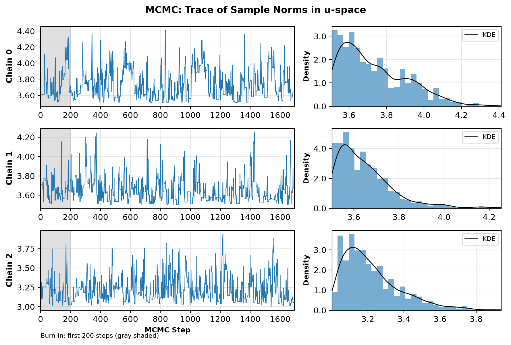

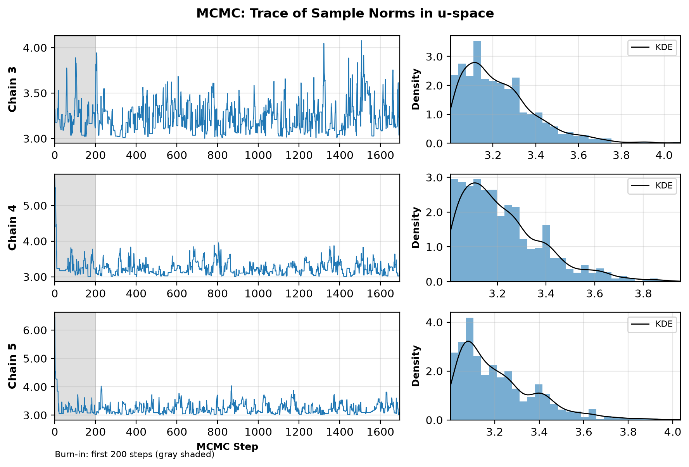

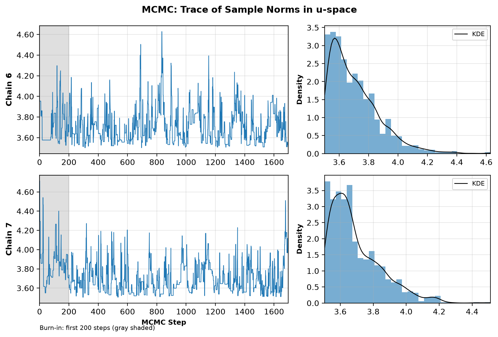

### Figure 4: Chain Convergence Diagnostics

The rank plot shows, for each chain, how its samples rank among the samples of all chains. When the chains sample the same distribution, the bars of every chain are roughly level. The autocorrelation plot shows how strongly each sample depends on earlier samples in the same chain. Faster decay toward zero means more independent information per sample, which gives a larger effective sample size (`ess_bulk`, `ess_tail`).

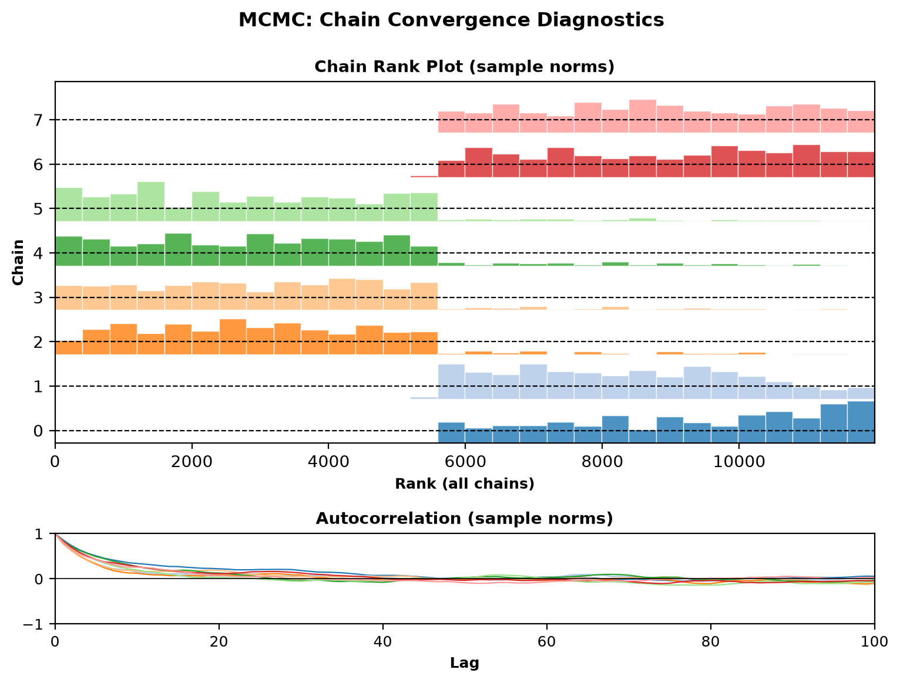

### Figure 5: MCMC Samples by Chain (u-space)

The MCMC samples kept after burn-in and thinning, in standard normal space, with one color per chain (the same colors as in Figure 4). The red curve is the limit state surface, and the dash-dot curves are contours of the standard normal probability density.

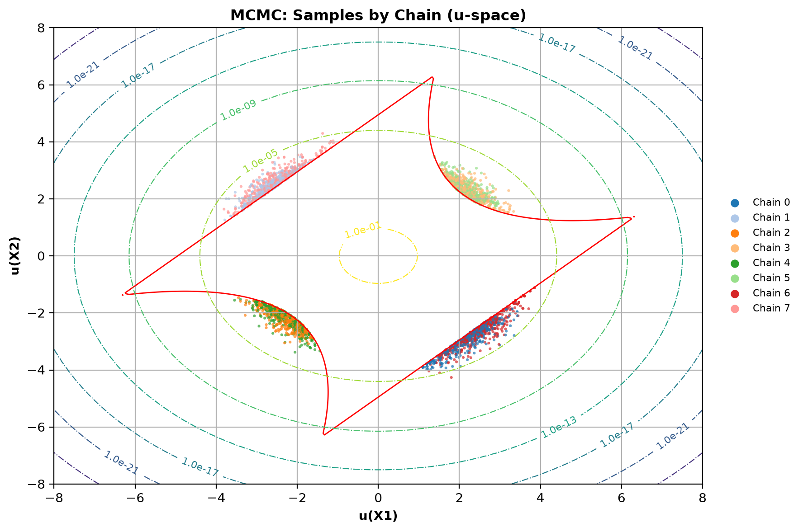

### Figure 6: MCMC Samples by Chain (x-space)

The same samples in the original variable space (`X1`, `X2`). Because both variables are standard normal, this figure matches Figure 5.

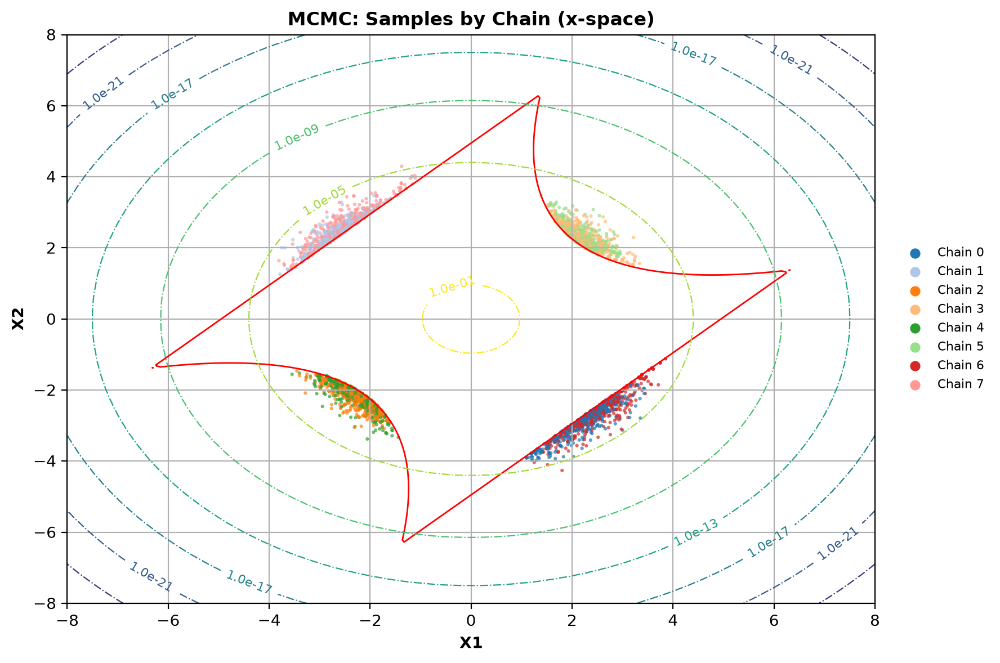

### Figure 7: IS Proposal Diagnostics (u-space)

The same MCMC samples, colored by the density of the proposal distribution fitted to them.

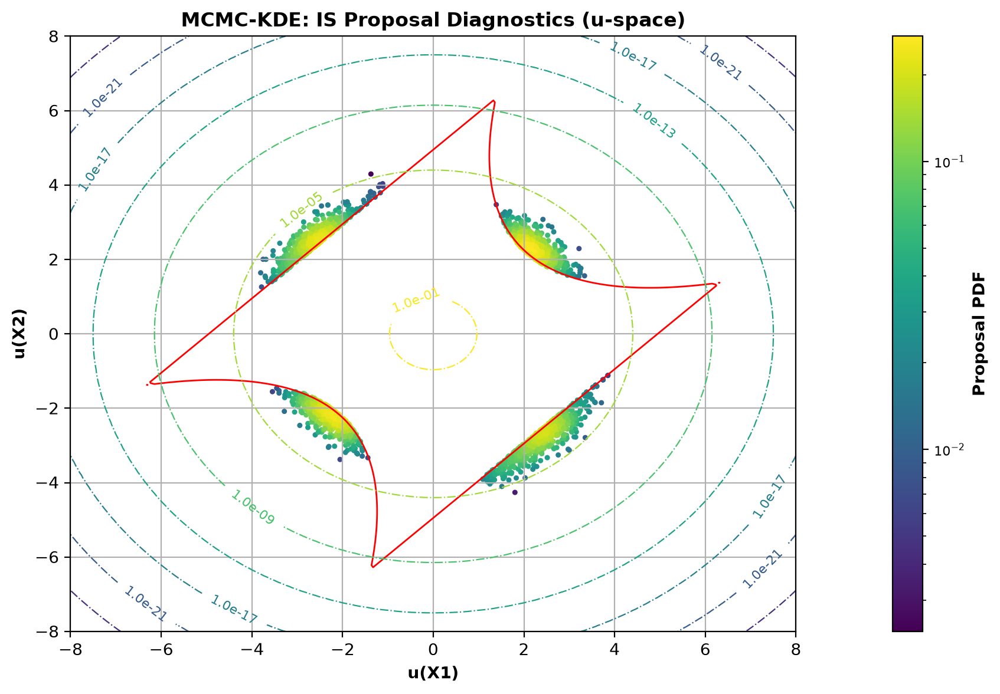

### Figure 8: IS Proposal Diagnostics (x-space)

The same as Figure 7, in the original variable space.

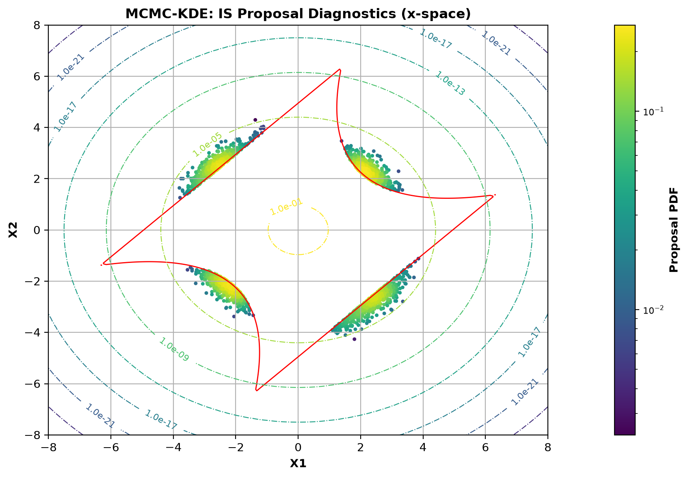

### Figure 9: IS Histogram — `X1`

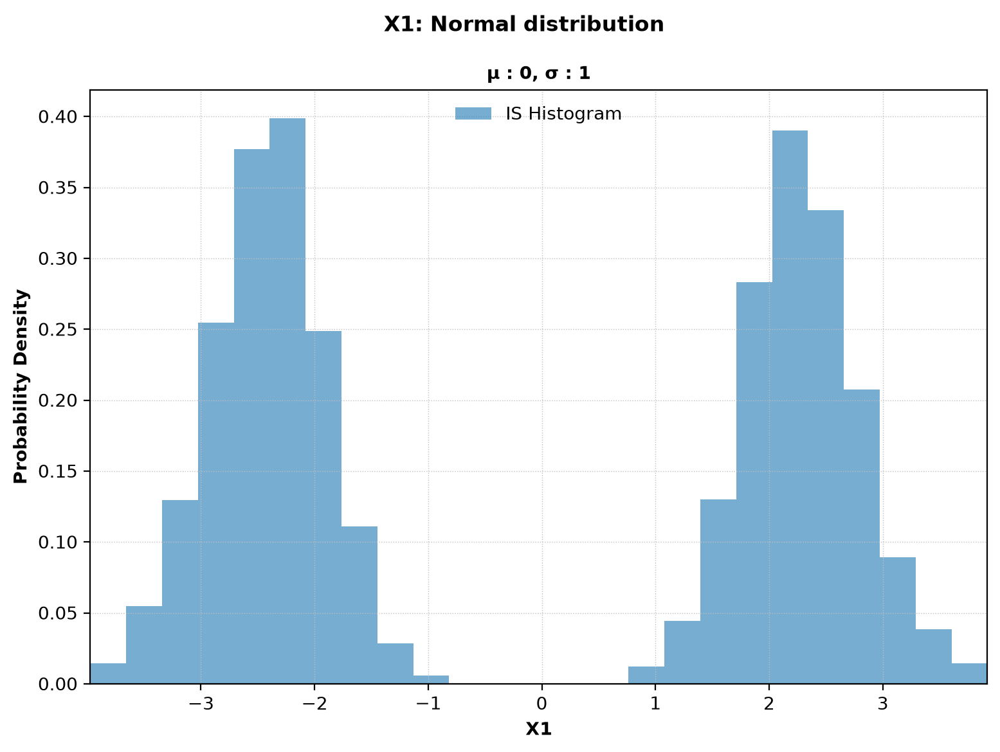

### Figure 10: IS Histogram — `X2`

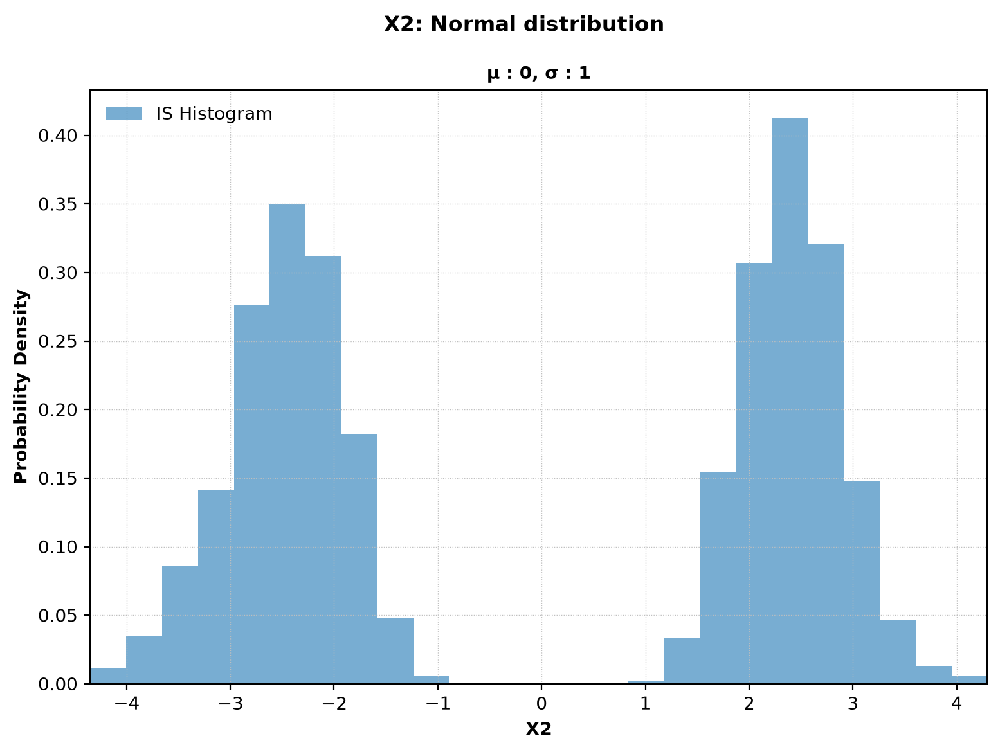

### Figure 11: Limit State Function Histogram (Importance Sampling)

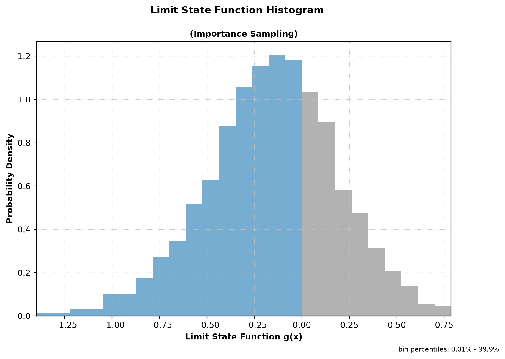

## Parts at the Same Distance: AU2

The `AU2` problem from the [Importance Sampling](importance-sampling.md) example shows the opposite case. Its failure region has three parts, all about 5 from the origin (**Figure 12**). A run with `is_method: mcmc` and the default MCMC settings (`results/2026-11-18/19-28-30/AU2-57473.xlsx`) gave:

| beta | pf | cv | r_hat | ess_bulk | ess_tail |
|---:|---:|---:|---:|---:|---:|
| 4.7876 | 8.439e−7 | 0.02441 | 1.023 | 410.9 | 660.8 |

- **Figure 12** shows that the chains split over the three parts: chains 0 and 3 in the lower-left corner, chains 1 and 4 on the arc along the top (component 1), and chain 2 on the arc and in the upper-right corner (component 2). The arc and the upper-right branch meet, so a chain can move from one to the other, as chain 2 did.
- `r_hat = 1.023` is still close to 1. Chains in different parts have similar norms, so the parts don't raise it, and `r_hat` alone can't show whether the chains found every part. **Figure 12** shows that.
- The KDE run on the [Importance Sampling](importance-sampling.md) page gives a similar probability of failure, `9.201e−7`, with `cv = 0.031`. Building the proposal with MCMC took 8,587 limit state function calls, about 13 times fewer than with KDE. That matters most when each call is expensive.

!!! note "Comparison with the paper"
    Au and Beck (1999) build the proposal distribution with MCMC. Brinkpy's estimate, `pf = 8.439e−7`, is larger than the `6.97e−7` published in the paper. Brinkpy's MCMC chains find a part of the failure region that the published solution does not include (see **Figure 12**). When the variables are bounded to the region used in the paper, Brinkpy's estimate matches the published one within the variation expected from random sampling. See [Verification](../../why-brinkpy.md#verification).

    **Source:** Au, S. K. and Beck, J. L., "A new adaptive importance sampling scheme for reliability calculations," *Structural Safety*, vol. 21, no. 2, 1999, pp. 135–158. [→](https://people.duke.edu/~hpgavin/risk/Au-1999.pdf)

### Figure 12: AU2 MCMC Samples by Chain (u-space)

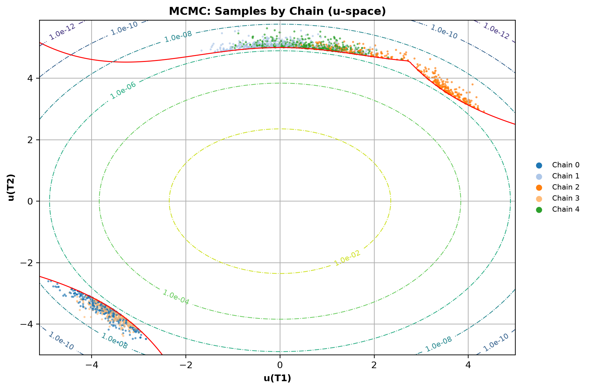
